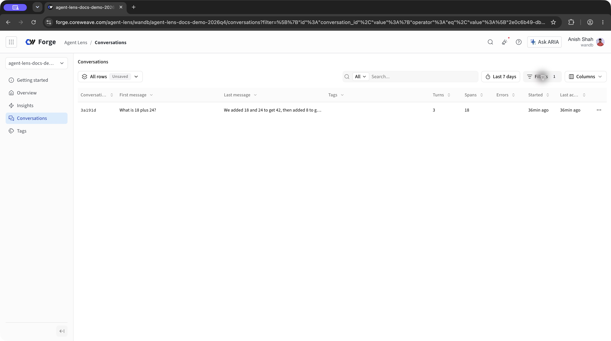

# CoreWeave Agent Lens observability for ADK

<div class="language-support-tag"><span class="lst-supported">Supported in ADK</span><span class="lst-python">Python</span></div>

[CoreWeave Agent Lens](https://docs.coreweave.com/products/agent-lens) displays
ADK sessions as conversations containing turns, model calls, and tool calls.
The `weave` Python package instruments ADK and exports its agent spans to Agent Lens.

## Overview

- **Conversation grouping**: Reuse one ADK session to inspect related turns together.
- **Execution details**: Open a turn to inspect model messages and tool arguments and results.

## Installation

Use Python 3.11 or later and install the packages:

```bash
pip install weave google-adk
```

## Setup

You need a [CoreWeave Forge account](https://forge.coreweave.com), a project,
a [Forge API key](https://forge.coreweave.com/settings#apikeys), and a
[Gemini API key](https://aistudio.google.com/apikey). Configure the environment:

```bash
export WANDB_API_KEY="YOUR_FORGE_API_KEY"
export FORGE_TRACE_PROJECT="YOUR_TEAM/YOUR_PROJECT"
export GOOGLE_API_KEY="YOUR_GOOGLE_API_KEY"
```

The example sends prompts, responses, and tool content to the configured
project. Use data you are authorized to record. Model requests use your Gemini
account.

## Observe

Save the following example as `agent_lens_demo.py`. It imports ADK before
calling `weave.init()` and reuses the same `session.id` for all three questions.
When migrating an existing setup, replace its classic `/otel/v1/traces` exporter
with the instrumentation below to avoid duplicate exports.

```python
import asyncio
import os

import weave
from google.adk.agents import Agent
from google.adk.runners import InMemoryRunner
from google.genai import types


def calculator(a: float, b: float) -> str:
    """Add two numbers and return their sum.

    Args:
        a: The first number.
        b: The second number.
    """
    return str(a + b)


root_agent = Agent(
    name="calculator_agent",
    model="gemini-flash-latest",
    instruction="Use calculator for addition. Use the conversation history for follow-up questions.",
    tools=[calculator],
)


async def main():
    weave.init(os.environ["FORGE_TRACE_PROJECT"])
    runner = InMemoryRunner(agent=root_agent, app_name="agent-lens-adk-demo")
    try:
        session = await runner.session_service.create_session(
            app_name="agent-lens-adk-demo", user_id="demo-user"
        )
        print(f"ADK session: {session.id}")
        for question in [
            "What is 18 plus 24?",
            "Add 8 to that result.",
            "Summarize the two calculations.",
        ]:
            print(f"User: {question}")
            async for event in runner.run_async(
                user_id="demo-user",
                session_id=session.id,
                new_message=types.Content(role="user", parts=[types.Part(text=question)]),
            ):
                if event.is_final_response() and event.content:
                    print("Agent:", "".join(part.text or "" for part in event.content.parts or []))
        return session.id
    finally:
        await runner.close()
        weave.finish()


if __name__ == "__main__":
    asyncio.run(main())
```

Run the example:

```bash
python agent_lens_demo.py
```

Open `https://forge.coreweave.com/agent-lens/YOUR_TEAM/YOUR_PROJECT` and select
**Conversations**. Open the conversation matching the printed ADK session ID.
The three questions should appear as three turns in one conversation. Expand a
turn to inspect its model calls and `calculator` tool calls. Creating a new ADK
session for each question would split them into separate conversations.



Select the conversation, expand **1 tool call**, then expand **calculator** to
inspect its input and output:


These screenshots were captured on October 22, 2026, using ADK 2.12.0 and
Weave 0.53.12 with scripted model responses and real ADK tool execution.
The example above calls Gemini; its model responses and timings can differ.

## Support and Resources

- [Agent Lens ADK guide](https://docs.coreweave.com/products/agent-lens/integrations/google-adk)
- [Python instrumentation source](https://github.com/wandb/weave)
- [Report an instrumentation issue](https://github.com/wandb/weave/issues)
