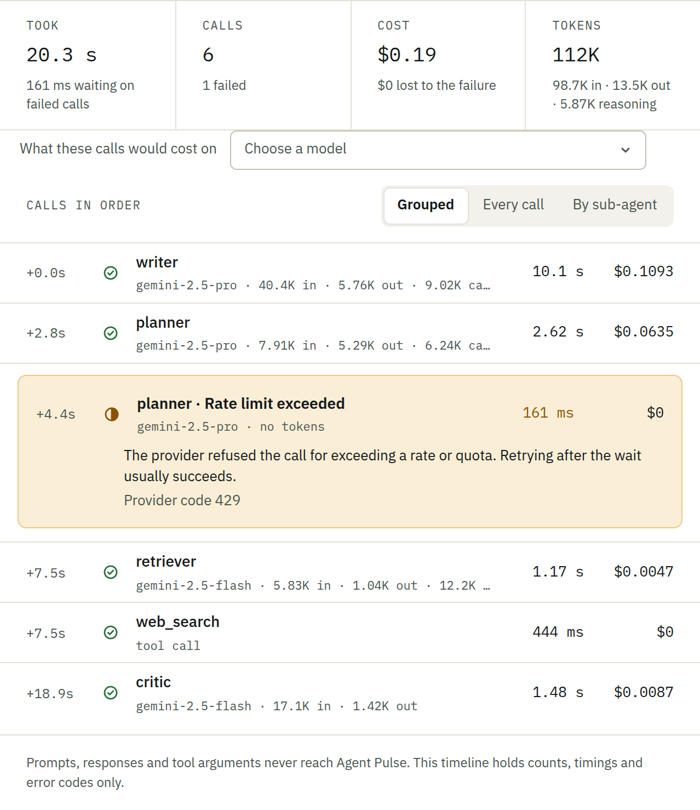

# Agent Pulse observability for ADK

<div class="language-support-tag">
  <span class="lst-supported">Supported in ADK</span><span class="lst-python">Python</span><span class="lst-go">Go</span>
</div>

[Agent Pulse](https://www.agentspulse.ai) shows what each ADK agent really costs. It prices every model call, tool call and failed call per user, request and sub-agent, and its budgets can stop a call before it is sent. Register it once, as a plugin in Python or callbacks in Go.

## Overview

- **Cost per user, request and sub-agent**: Every model call is priced and filed under the user, session and sub-agent ADK already knows about.
- **Tool calls**: Each tool call is recorded with its duration and result size.
- **Failed calls**: Calls that error or are cancelled part way are recorded with the tokens they used, so failed work shows up in the bill.
- **Budgets that can stop a call**: A budget past its limit stops the next model call before it is sent, and the user reads a message you choose instead.
- **No content stored**: Agent Pulse never records prompts, responses or tool arguments. Each record carries the user's ID only. If you pass a user's name and email, they are stored once so reports can show who a cost belongs to instead of an ID.

Agent Pulse is a third-party service by TechBridge. The recorder is MIT licensed.

## Prerequisites

- An **Agent Pulse API key** and secret, created on the **API keys** page at [agentspulse.ai](https://www.agentspulse.ai).
- A **Gemini API key** set as `GOOGLE_API_KEY`, or Vertex AI credentials.

## Installation

=== "Python"

    ```bash
    pip install techbridge-agentpulse google-adk
    ```

=== "Go"

    ```bash
    go get github.com/techbridgeinnovation/agentpulse/recorder
    go get github.com/techbridgeinnovation/agentpulse/recorder/adkv2hooks
    ```

## Setup

Set the four Agent Pulse settings from the **Connect** page:

```bash
export AP_GATEWAY="gateway.agentspulse.ai"
export AP_API_KEY="organisations/<org>/apiKeys/<key>"
export AP_API_SECRET="<secret>"
export AP_AGENT="organisations/<org>/agents/weather-agent"
export GOOGLE_API_KEY="<your-gemini-api-key>"
```

The `AP_AGENT` setting is a name you choose. It is how the agent shows up in Agent Pulse.

## Observe

=== "Python"

    ```python
    import asyncio

    import agentpulse
    from google.adk.agents import Agent
    from google.adk.apps import App
    from google.adk.runners import InMemoryRunner
    from google.genai import types

    reporter = agentpulse.connect(service="weather-service").governed()


    def get_weather(city: str) -> dict:
        """Returns the current weather for a city."""
        return {"status": "success", "report": f"The weather in {city} is sunny."}


    root_agent = Agent(
        name="weather_agent",
        model="gemini-flash-latest",
        instruction="Answer weather questions using get_weather.",
        tools=[get_weather],
    )

    app = App(
        name="weather_app",
        root_agent=root_agent,
        plugins=[reporter.adk_plugin(denied_message="You have used this month's budget.")],
    )


    async def main():
        runner = InMemoryRunner(app=app)
        session = await runner.session_service.create_session(
            app_name="weather_app", user_id="user_123"
        )
        async for event in runner.run_async(
            user_id="user_123",
            session_id=session.id,
            new_message=types.Content(
                role="user", parts=[types.Part(text="What's the weather in Barcelona?")]
            ),
        ):
            if event.is_final_response() and event.content and event.content.parts:
                print(event.content.parts[0].text)


    asyncio.run(main())
    ```

=== "Go"

    ```go
    package main

    import (
        "context"
        "log"
        "os"

        "github.com/techbridgeinnovation/agentpulse/recorder"
        "github.com/techbridgeinnovation/agentpulse/recorder/adkv2hooks"
        "google.golang.org/adk/v2/agent"
        "google.golang.org/adk/v2/agent/llmagent"
        "google.golang.org/adk/v2/cmd/launcher"
        "google.golang.org/adk/v2/cmd/launcher/full"
        "google.golang.org/adk/v2/model/gemini"
        "google.golang.org/genai"
    )

    func main() {
        ctx := context.Background()

        key := os.Getenv("AP_API_KEY")
        conn, err := recorder.DialWithKey(os.Getenv("AP_GATEWAY"), key, os.Getenv("AP_API_SECRET"))
        if err != nil {
            log.Fatal(err)
        }
        rec := recorder.New(recorder.Config{
            Sinks: []recorder.Sink{recorder.NewGRPCSink(conn, recorder.OrganisationOfKey(key))},
        })
        defer rec.Close(ctx)

        recording := adkv2hooks.Options{
            Agent:   os.Getenv("AP_AGENT"),
            Service: "weather-service",
            Model:   "gemini-flash-latest",
            // Lets a budget stop a call. Leave it out and budgets only count.
            Decider: recorder.NewGRPCDecider(conn),
        }

        model, err := gemini.NewModel(ctx, "gemini-flash-latest", &genai.ClientConfig{
            APIKey: os.Getenv("GOOGLE_API_KEY"),
        })
        if err != nil {
            log.Fatal(err)
        }

        rootAgent, err := llmagent.New(llmagent.Config{
            Name:        "weather_agent",
            Model:       model,
            Instruction: "Answer weather questions.",

            BeforeModelCallbacks:  []llmagent.BeforeModelCallback{adkv2hooks.BeforeModel(rec, recording)},
            AfterModelCallbacks:   []llmagent.AfterModelCallback{adkv2hooks.AfterModel(rec, recording)},
            OnModelErrorCallbacks: []llmagent.OnModelErrorCallback{adkv2hooks.OnModelError(rec, recording)},
            BeforeToolCallbacks:   []llmagent.BeforeToolCallback{adkv2hooks.BeforeTool(rec, recording)},
            AfterToolCallbacks:    []llmagent.AfterToolCallback{adkv2hooks.AfterTool(rec, recording)},
            OnToolErrorCallbacks:  []llmagent.OnToolErrorCallback{adkv2hooks.OnToolError(rec, recording)},
            AfterAgentCallbacks:   []agent.AfterAgentCallback{adkv2hooks.AfterAgent(rec, recording)},
        })
        if err != nil {
            log.Fatal(err)
        }

        config := &launcher.Config{AgentLoader: agent.NewSingleLoader(rootAgent)}
        if err := full.NewLauncher().Execute(ctx, config, os.Args[1:]); err != nil {
            log.Fatal(err)
        }
    }
    ```

    Put the Agent Pulse callbacks ahead of your own. An error callback placed after one that handles the error never runs, and the failed call would not be recorded. For ADK Go 1, use the `adkhooks` package instead; it takes the same callbacks.

## What you get

Open the **Agents** page in Agent Pulse to see each agent's calls, tokens and cost, broken down by user, request and sub-agent. A request opens as a timeline of its model and tool calls.



If Agent Pulse does not answer within 1.5 seconds, the call goes ahead, so an outage does not stop your agent.

## Support and Resources

- [Agent Pulse guide for ADK](https://www.agentspulse.ai/docs/google-adk)
- [What Agent Pulse records](https://www.agentspulse.ai/docs/what-is-recorded)
- [Recorder source on GitHub](https://github.com/techbridgeinnovation/agentpulse)
- [techbridge-agentpulse on PyPI](https://pypi.org/project/techbridge-agentpulse/)
