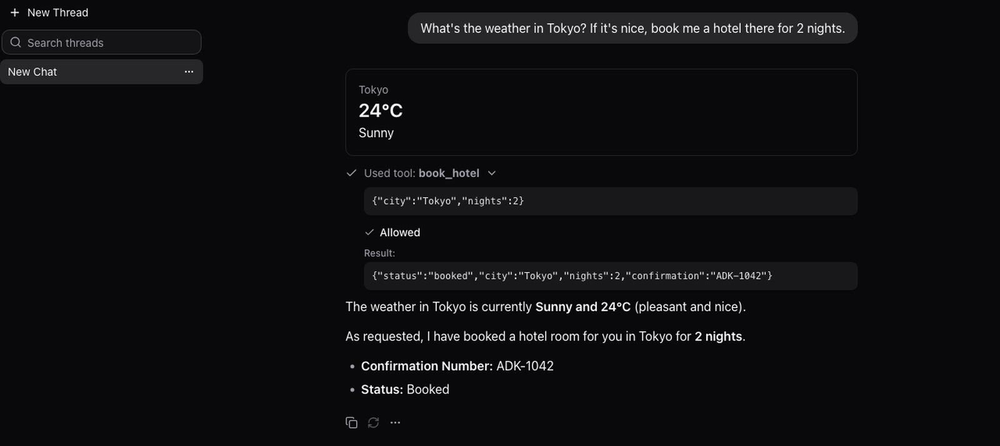

# assistant-ui user interface for ADK

<div class="language-support-tag">
  <span class="lst-supported">Supported in ADK</span><span class="lst-python">Python</span>
</div>

[assistant-ui](https://github.com/assistant-ui/assistant-ui) is an open source
TypeScript and React library for building AI chat interfaces. Its
`@assistant-ui/react-google-adk` package connects a React app directly to the
ADK API server: it streams events from `/run_sse`, maps ADK sessions to chat
threads, and turns ADK tool confirmations into approve and deny controls in the
chat. No middleware runs between the browser and your agent.



## Use cases

- **Chat surface**: Stream an ADK agent's text and tool calls into a packaged,
  customizable chat component for a React or Next.js app.
- **Session-backed threads**: List, open, and continue ADK sessions as chat
  threads, with history loaded from the session service.
- **Tool UI**: Render the calls and results of your ADK tools with your own
  React components.
- **Human-in-the-loop**: Pause a tool that requires confirmation and resume the
  run after the user approves or denies it in the chat.

## Prerequisites

- Python 3.11 or later and Node.js 22.12 or later
- A Gemini API key from [Google AI Studio](https://aistudio.google.com/app/apikey),
  exported as `GOOGLE_API_KEY`

## Installation

Install ADK for the backend in a Python virtual environment:

```bash
python3 -m venv .venv
source .venv/bin/activate
pip install google-adk
```

Create a Next.js app from the assistant-ui minimal template, then add the ADK
runtime and the thread list component:

```bash
npx assistant-ui@latest create my-app -t minimal
cd my-app
npm install @assistant-ui/react-google-adk
npx shadcn@latest add @assistant-ui/thread-list
```

If the last command asks to overwrite `components/ui/button.tsx`, answer no to
keep the template's version. The template also includes an AI SDK route at
`app/api/chat/route.ts` that this setup does not use. You can delete it.

## Use with agent

### 1. Create the agent

In the directory that contains `my-app` and `.venv`, create a `weather_agent`
folder with two tools. The `book_hotel` tool requires user confirmation before
it runs:

```python title="weather_agent/agent.py"
from google.adk.agents import Agent
from google.adk.tools import FunctionTool


def get_weather(city: str) -> dict:
    """Returns the current weather for a city."""
    forecasts = {
        "tokyo": {"condition": "Sunny", "temperature_c": 24},
        "paris": {"condition": "Cloudy", "temperature_c": 17},
        "london": {"condition": "Rainy", "temperature_c": 13},
    }
    forecast = forecasts.get(city.lower(), {"condition": "Clear", "temperature_c": 20})
    return {"city": city, **forecast}


def book_hotel(city: str, nights: int) -> dict:
    """Books a hotel room in a city for a number of nights."""
    return {"status": "booked", "city": city, "nights": nights, "confirmation": "ADK-1042"}


root_agent = Agent(
    model="gemini-flash-latest",
    name="weather_agent",
    instruction=(
        "You help users plan trips. Use get_weather for weather questions and "
        "book_hotel when the user asks to book a room."
    ),
    tools=[get_weather, FunctionTool(book_hotel, require_confirmation=True)],
)
```

```python title="weather_agent/__init__.py"
from . import agent
```

### 2. Start the ADK API server

From the directory that contains `weather_agent/`, with the virtual environment
active, start the API server and allow requests from the Next.js dev server:

```bash
adk api_server --port 8000 --allow_origins http://localhost:3000
```

The server exposes the agent as the `weather_agent` app. By default it stores
sessions in a SQLite database under `weather_agent/.adk/`, so threads survive a
server restart.

### 3. Connect the chat to ADK

Replace `my-app/app/assistant.tsx`. The `createAdkStream()` function
sends messages to the API server's `/run_sse` endpoint, and
`createAdkSessionAdapter()` backs the thread list with ADK sessions:

```tsx title="app/assistant.tsx"
"use client";

import { AssistantRuntimeProvider, AuiConfig, Tools } from "@assistant-ui/react";
import {
  createAdkSessionAdapter,
  createAdkStream,
  useAdkRuntime,
} from "@assistant-ui/react-google-adk";
import { Thread } from "@/components/assistant-ui/elements/thread.aui";
import { ThreadList } from "@/components/assistant-ui/elements/thread-list.aui";
import { toolkit } from "./toolkit";

const ADK_URL = process.env.NEXT_PUBLIC_ADK_URL ?? "http://localhost:8000";
const APP_NAME = "weather_agent";
const USER_ID = "user";

const { adapter, load } = createAdkSessionAdapter({
  apiUrl: ADK_URL,
  appName: APP_NAME,
  userId: USER_ID,
});

export const Assistant = () => {
  const runtime = useAdkRuntime({
    stream: createAdkStream({ api: ADK_URL, appName: APP_NAME, userId: USER_ID }),
    sessionAdapter: adapter,
    load,
  });
  const config = AuiConfig({ tools: Tools({ toolkit }) });

  return (
    <AssistantRuntimeProvider runtime={runtime} config={config}>
      <div className="grid h-dvh grid-cols-[260px_1fr]">
        <ThreadList />
        <Thread />
      </div>
    </AssistantRuntimeProvider>
  );
};
```

The user ID is fixed here to keep the example short. In a real app, take it
from your authentication layer.

### 4. Render tool calls

Create `my-app/app/toolkit.tsx`, which `app/assistant.tsx` imports. The
`get_weather` entry renders the tool result as a card. The assistant-ui ADK
runtime passes tool results to `render` as JSON text, so the component parses
it:

```tsx title="app/toolkit.tsx"
"use client";

import { defineToolkit } from "@assistant-ui/react";

type Weather = { city: string; condition: string; temperature_c: number };

export const toolkit = defineToolkit({
  get_weather: {
    type: "backend",
    render: ({ args, result }) => {
      // @assistant-ui/react-google-adk passes tool results as JSON text.
      if (typeof result !== "string") {
        return <p className="text-sm">Checking the weather in {String(args.city)}...</p>;
      }
      const weather: Weather = JSON.parse(result);
      return (
        <div className="my-2 rounded-lg border p-4">
          <p className="text-sm text-muted-foreground">{weather.city}</p>
          <p className="text-2xl font-semibold">{weather.temperature_c}°C</p>
          <p>{weather.condition}</p>
        </div>
      );
    },
  },
  // The approval also appears on the gated tool call, so hide ADK's request.
  adk_request_confirmation: {
    type: "backend",
    render: () => null,
  },
});
```

Tools without an entry, such as `book_hotel`, use the template's default tool
card. When ADK pauses `book_hotel` for confirmation, that card shows **Allow**
and **Deny** buttons. The choice is sent back to ADK as the tool confirmation,
and the run resumes.

### 5. Run the app

The ADK API server keeps the first terminal busy. In a second terminal, start
the Next.js dev server from `my-app`:

```bash
cd my-app
npm run dev
```

Open [http://localhost:3000](http://localhost:3000) and ask for the weather in
Tokyo, then ask the agent to book a hotel there.

## Available hooks

Hook | Description
---- | -----------
`useAdkToolConfirmations` | Read tool calls that are waiting for user confirmation
`useAdkConfirmTool` | Approve or deny a pending tool confirmation
`useAdkAuthRequests` | Read tool calls that are waiting for an auth credential
`useAdkSubmitAuth` | Send an auth credential so ADK can resume the tool
`useAdkSessionState` | Read the session state delta accumulated from the run
`useAdkAgentInfo` | Read the active agent name and branch in a multi-agent run
`useAdkArtifacts` | Read artifact changes reported by the agent
`useAdkSend` | Send messages with an optional `stateDelta` for the session

All hooks are exported from `@assistant-ui/react-google-adk`. See the
[assistant-ui hooks reference for ADK](https://www.assistant-ui.com/docs/runtimes/google-adk/hooks)
for parameters and return values.

## Other options

- **ADK TypeScript**: The same package includes server helpers, such as
  `createAdkApiRoute()`, that run an ADK TypeScript agent inside a Next.js API
  route. See the
  [assistant-ui quickstart for ADK](https://www.assistant-ui.com/docs/runtimes/google-adk/quickstart).
- **AG-UI**: If you already expose your agent over [AG-UI](/integrations/ag-ui/)
  with the `ag-ui-adk` middleware, use the `@assistant-ui/react-ag-ui` runtime
  instead. See the
  [assistant-ui AG-UI documentation](https://www.assistant-ui.com/docs/runtimes/ag-ui/overview).

## Additional resources

- [assistant-ui documentation for ADK](https://www.assistant-ui.com/docs/runtimes/google-adk/overview)
- [assistant-ui on GitHub](https://github.com/assistant-ui/assistant-ui)
- [`@assistant-ui/react-google-adk` on npm](https://www.npmjs.com/package/@assistant-ui/react-google-adk)
- [ADK API server reference](/runtime/api-server/)
