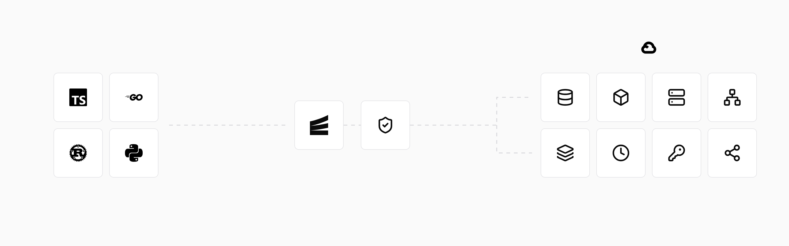

# Encore integration for ADK

<div class="language-support-tag">
  <span class="lst-supported">Supported in ADK</span><span class="lst-go">Go</span>
</div>

[Encore](https://encore.dev) lets you run ADK Go agents as services in your own Google Cloud project, with ADK sessions stored in Postgres and function tools that call your other services. You declare infrastructure like databases, Pub/Sub topics and cron jobs in Go code, and Encore runs them on your machine and provisions them in that project when you deploy.



## Use cases

- **Agents in your product**: Serve chat or assistant features as APIs, with
  conversation history in a Postgres database in your Google Cloud project.
- **Agents that use your systems**: Give agents tools that call your other
  Encore services like Go functions, with the networking between them set up
  in your Google Cloud project.
- **Background agents**: Run agents on a schedule or when an event arrives,
  with the Pub/Sub topics set up in your Google Cloud project.

## Overview

With Encore, your ADK Go agent gets:

- **Agent as an API**: The ADK runner is served from an Encore API endpoint.
  Sessions use the ADK `session/database` store on an Encore Postgres database,
  so conversations persist across requests and restarts.
- **Tools that call your services**: A function tool can call another Encore
  service's API as a plain Go function call.
- **Scheduled and event-driven runs**: Cron jobs and Pub/Sub subscribers can
  run the agent without a user request.
- **Secrets**: The model API key is declared in code and set with the Encore
  CLI.
- **Tracing**: Each request is traced, including HTTP calls to the model
  API, tool calls to other services and database queries, so you can see each
  step of an agent turn, locally and in deployed environments.
- **Preview environments**: Each pull request can get its own environment.

## How it works

You declare infrastructure as Go variables and annotations next to the code
that uses it. Encore reads these declarations with
[static analysis](https://encore.dev/docs/go/concepts/application-model), runs them
on your machine with `encore run`, and provisions them in your project when you
deploy:

```go
// A Postgres database with its migrations.
var db = sqldb.NewDatabase("agent", sqldb.DatabaseConfig{Migrations: "./migrations"})

// A Pub/Sub topic.
var Events = pubsub.NewTopic[*Event]("events", pubsub.TopicConfig{
	DeliveryGuarantee: pubsub.AtLeastOnce,
})

// Secrets, loaded at startup.
var secrets struct {
	GoogleAPIKey string
}

// A public API endpoint.
//encore:api public method=POST path=/chat
func Chat(ctx context.Context, p *ChatParams) (*ChatResponse, error) {
	// ...
}
```

When you deploy, each declaration maps to:

| Declared in Go code | In your Google Cloud project |
| --- | --- |
| Services | Cloud Run or GKE |
| SQL databases | Cloud SQL for PostgreSQL |
| Pub/Sub topics and subscriptions | Pub/Sub |
| Secrets | Secret Manager |
| Cron jobs | No extra resources |

## Prerequisites

- Go 1.26.10 or later
- [Encore CLI](https://encore.dev/docs/go/install)
- An Encore account, created with `encore auth signup`, to set secrets and
  deploy
- Docker, to run Postgres locally
- A [Gemini API key](https://aistudio.google.com/app/api-keys) (or any
  [supported model](/agents/models/))

## Installation

Create an Encore app from the `hello-world` example and add ADK:

```bash
encore app create my-agent --example=hello-world --lang=go
cd my-agent
go get google.golang.org/adk/v2 gorm.io/driver/postgres gorm.io/gorm
```

The app includes a `hello` service with a `World` API. The agent below calls it
from a function tool.

## Use with agent

### 1. Add the session tables

Encore applies migrations before the service starts, both with `encore run`
and during deploys. The service connects with a role that can't create
tables, so the tables for the ADK `session/database` store go in a migration.
Create `agent/migrations/1_adk_sessions.up.sql` with this schema:

??? example "ADK session tables"

    ```sql title="agent/migrations/1_adk_sessions.up.sql"
    CREATE TABLE sessions (
        app_name TEXT NOT NULL,
        user_id TEXT NOT NULL,
        id TEXT NOT NULL,
        state JSONB,
        create_time TIMESTAMP(6) WITH TIME ZONE,
        update_time TIMESTAMP(6) WITH TIME ZONE,
        PRIMARY KEY (app_name, user_id, id)
    );

    CREATE TABLE events (
        id TEXT NOT NULL,
        app_name TEXT NOT NULL,
        user_id TEXT NOT NULL,
        session_id TEXT NOT NULL,
        invocation_id TEXT,
        author TEXT,
        actions BYTEA,
        long_running_tool_ids_json JSONB,
        routes_json JSONB,
        output_json JSONB,
        node_info_json JSONB,
        requested_input_json JSONB,
        branch TEXT,
        isolation_scope TEXT,
        "timestamp" TIMESTAMP(6) WITH TIME ZONE,
        content JSONB,
        grounding_metadata JSONB,
        custom_metadata JSONB,
        usage_metadata JSONB,
        citation_metadata JSONB,
        input_transcription JSONB,
        output_transcription JSONB,
        partial BOOLEAN,
        turn_complete BOOLEAN,
        error_code TEXT,
        error_message TEXT,
        interrupted BOOLEAN,
        PRIMARY KEY (id, app_name, user_id, session_id),
        CONSTRAINT fk_sessions_events FOREIGN KEY (app_name, user_id, session_id) REFERENCES sessions (app_name, user_id, id) ON DELETE CASCADE
    );

    CREATE TABLE app_states (
        app_name TEXT PRIMARY KEY,
        state JSONB,
        update_time TIMESTAMP(6) WITH TIME ZONE
    );

    CREATE TABLE user_states (
        app_name TEXT NOT NULL,
        user_id TEXT NOT NULL,
        state JSONB,
        update_time TIMESTAMP(6) WITH TIME ZONE,
        PRIMARY KEY (app_name, user_id)
    );
    ```

### 2. Create the agent service

Create `agent/agent.go`. It declares the database and the API key secret, wraps
the `hello.World` API as a function tool, and exposes a `/chat` endpoint that
runs one turn:

```go title="agent/agent.go"
package agent

import (
	"context"

	"encore.app/hello"
	"encore.dev/storage/sqldb"
	"google.golang.org/adk/v2/agent"
	"google.golang.org/adk/v2/agent/llmagent"
	"google.golang.org/adk/v2/model/gemini"
	"google.golang.org/adk/v2/runner"
	"google.golang.org/adk/v2/session"
	"google.golang.org/adk/v2/session/database"
	"google.golang.org/adk/v2/tool"
	"google.golang.org/adk/v2/tool/functiontool"
	"google.golang.org/genai"
	"gorm.io/driver/postgres"
	"gorm.io/gorm"
)

const appName = "assistant"

// A Postgres database. Runs in Docker locally and on Cloud SQL on GCP.
var db = sqldb.NewDatabase("agent", sqldb.DatabaseConfig{Migrations: "./migrations"})

// Secrets, loaded at startup and set with `encore secret set`.
// On GCP they are stored in Secret Manager.
var secrets struct {
	GoogleAPIKey string
}

type greetArgs struct {
	Name string `json:"name" jsonschema:"the name of the person to greet"`
}

type greetResult struct {
	Message string `json:"message"`
}

// Makes this package a service. On GCP it runs on Cloud Run or GKE.
//encore:service
type Service struct {
	runner   *runner.Runner
	sessions session.Service
}

func initService() (*Service, error) {
	ctx := context.Background()

	sessions, err := database.NewSessionService(
		postgres.New(postgres.Config{Conn: db.Stdlib()}),
		&gorm.Config{},
	)
	if err != nil {
		return nil, err
	}

	model, err := gemini.NewModel(ctx, "gemini-flash-latest", &genai.ClientConfig{
		APIKey:  secrets.GoogleAPIKey,
		Backend: genai.BackendGeminiAPI,
	})
	if err != nil {
		return nil, err
	}

	// The tool calls the hello service's API like any other Go function.
	greet, err := functiontool.New(functiontool.Config{
		Name:        "greet",
		Description: "Greet a person by name.",
	}, func(ctx agent.Context, args greetArgs) (greetResult, error) {
		resp, err := hello.World(ctx, args.Name)
		if err != nil {
			return greetResult{}, err
		}
		return greetResult{Message: resp.Message}, nil
	})
	if err != nil {
		return nil, err
	}

	rootAgent, err := llmagent.New(llmagent.Config{
		Name:        appName,
		Model:       model,
		Instruction: "You are a helpful assistant. Use the greet tool when asked to greet someone. Keep answers brief.",
		Tools:       []tool.Tool{greet},
	})
	if err != nil {
		return nil, err
	}

	r, err := runner.New(runner.Config{
		AppName:        appName,
		Agent:          rootAgent,
		SessionService: sessions,
	})
	if err != nil {
		return nil, err
	}
	return &Service{runner: r, sessions: sessions}, nil
}

type ChatParams struct {
	UserID    string `json:"user_id"`
	SessionID string `json:"session_id"`
	Message   string `json:"message"`
}

type ChatResponse struct {
	SessionID string `json:"session_id"`
	Reply     string `json:"reply"`
}

// Exposes Chat as a public HTTP endpoint at POST /chat.
//encore:api public method=POST path=/chat
func (s *Service) Chat(ctx context.Context, p *ChatParams) (*ChatResponse, error) {
	if p.SessionID == "" {
		created, err := s.sessions.Create(ctx, &session.CreateRequest{
			AppName: appName,
			UserID:  p.UserID,
		})
		if err != nil {
			return nil, err
		}
		p.SessionID = created.Session.ID()
	}

	msg := genai.NewContentFromText(p.Message, genai.RoleUser)
	resp := &ChatResponse{SessionID: p.SessionID}
	for event, err := range s.runner.Run(ctx, p.UserID, p.SessionID, msg, agent.RunConfig{}) {
		if err != nil {
			return nil, err
		}
		if event.Content != nil && event.Author == appName {
			for _, part := range event.Content.Parts {
				resp.Reply += part.Text
			}
		}
	}
	return resp, nil
}
```

### 3. Run the agent on a schedule

Create `agent/cron.go` to run the agent once a day:

```go title="agent/cron.go"
package agent

import (
	"context"

	"encore.dev/cron"
	"encore.dev/rlog"
)

// Runs the agent once a day without a user request. In deployed
// environments the endpoint is called on this schedule.
var _ = cron.NewJob("daily-greeting", cron.JobConfig{
	Title:    "Daily agent run",
	Every:    24 * cron.Hour,
	Endpoint: DailyGreeting,
})

//encore:api private
func (s *Service) DailyGreeting(ctx context.Context) error {
	resp, err := s.Chat(ctx, &ChatParams{
		UserID:  "cron",
		Message: "Greet the team.",
	})
	if err != nil {
		return err
	}
	rlog.Info("daily greeting", "reply", resp.Reply)
	return nil
}
```

Cron jobs do not run locally or in preview environments. Call the endpoint
directly to test it.

### 4. Run the app

Set the API key and start the app:

```bash
encore secret set --type dev,preview,local GoogleAPIKey
encore run
```

Running `encore run` starts Postgres, applies the migration and serves the API on
`localhost:4000`. The local development dashboard at `localhost:9400` shows a
trace for each request, including the tool call and the session queries.

Send a message:

```bash
curl -X POST localhost:4000/chat \
  -d '{"user_id":"u1","message":"Say hello to Ada"}'
```

The response includes a `session_id`. Pass it in the next request to continue
the conversation:

```bash
curl -X POST localhost:4000/chat \
  -d '{"user_id":"u1","session_id":"<session_id>","message":"Thanks"}'
```

Trigger the scheduled run:

```bash
curl -X POST localhost:4000/agent.DailyGreeting
```

## Deploy

[Connect your Google Cloud project](https://encore.dev/docs/platform/deploy/own-cloud)
and push to deploy. Set `GoogleAPIKey` for each environment type you deploy to,
for example `encore secret set --type prod GoogleAPIKey`. You can also
[build a Docker image](https://encore.dev/docs/go/self-host/docker-build) and
run it yourself.

## Additional resources

- [ADK agent example](https://github.com/encoredev/examples/tree/main/adk-agent):
  streaming chat, a notes service called from tools, a Pub/Sub subscriber and
  a cleanup cron job
- [Encore Go documentation](https://encore.dev/docs/go)
- [GCP infrastructure provisioned by Encore](https://encore.dev/docs/platform/infrastructure/gcp)
- [Encore on GitHub](https://github.com/encoredev/encore)
