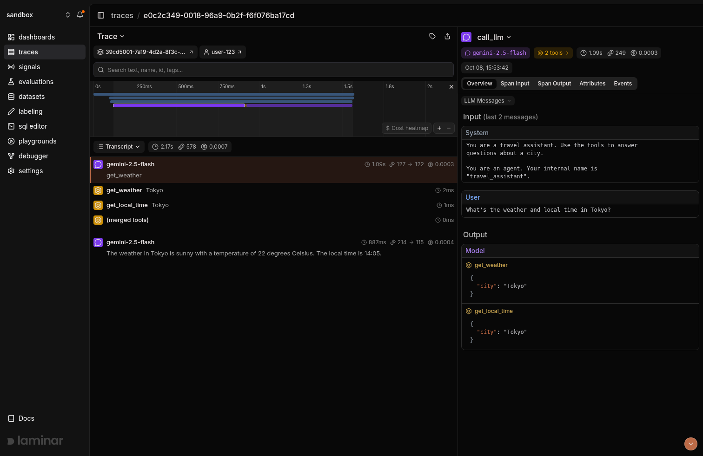

# Laminar observability for ADK

<div class="language-support-tag">
  <span class="lst-supported">Supported in ADK</span><span class="lst-python">Python</span>
</div>

[Laminar](https://laminar.sh) is an open-source observability platform for AI
agents. The Laminar Python SDK automatically instruments ADK, so every agent
run, model call, and tool call is captured as an OpenTelemetry trace that you
can inspect, search, and evaluate in Laminar. You can use the managed cloud or
[self-host](https://docs.laminar.sh/self-hosting/overview) Laminar.

## Overview

ADK emits OpenTelemetry spans for agent invocations, model calls, and tool
calls. When you initialize Laminar, it registers a global tracer provider that
collects these spans and adds detail to them:

- **Agent traces**: Capture each agent invocation with its model calls and tool
  calls as one trace, with tool calls shown as siblings of the model call that
  requested them
- **Model calls**: Record input and output messages, tool definitions, the
  response model, token usage, and cost for every Gemini call made by ADK
- **Tool calls**: Record the arguments and result of each tool call, including
  parallel tool calls
- **Sessions and users**: Attach the ADK `session_id` and `user_id` to each
  trace, so you can group and filter traces by conversation or user
- **Evaluation**: Run [evaluations](https://docs.laminar.sh/evaluations/introduction)
  and query trace data with [SQL](https://docs.laminar.sh/platform/sql-editor)

## Installation

```bash
pip install "lmnr>=0.7.67" "google-adk>=2"
```

ADK instrumentation is included in the default `lmnr` package. It supports ADK
2.x and requires Python 3.10 or later. With ADK 2.10 or later, use `lmnr`
0.7.67 or later to capture model prompts and responses.

## Setup

1. Sign up at [laminar.sh](https://laminar.sh) or
   [self-host](https://docs.laminar.sh/self-hosting/overview) Laminar.
2. Create a project and generate a project API key in the project settings.
3. Set your Laminar project API key and a
   [Gemini API key](https://aistudio.google.com/app/apikey):

    ```bash
    export LMNR_PROJECT_API_KEY="your-laminar-project-api-key"
    export GOOGLE_API_KEY="your-gemini-api-key"
    ```

4. Call `Laminar.initialize()` once at the start of your application, before
   you run any agents:

    ```python
    from lmnr import Laminar

    Laminar.initialize()  # Reads LMNR_PROJECT_API_KEY from the environment
    ```

When `google-adk` is installed, Laminar enables ADK instrumentation
automatically. No other code changes are needed.

## Observe

The following example runs an ADK agent with a tool. Each run appears as a trace
in your Laminar project:

```python
import asyncio

from google.adk.agents import Agent
from google.adk.runners import InMemoryRunner
from google.genai import types
from lmnr import Laminar

Laminar.initialize()


def get_weather(city: str) -> dict:
    """Retrieves the current weather report for a specified city.

    Args:
        city (str): The name of the city for which to retrieve the weather report.

    Returns:
        dict: status and result or error msg.
    """
    if city.lower() == "new york":
        return {
            "status": "success",
            "report": "The weather in New York is sunny with a temperature of 25 degrees Celsius.",
        }
    return {
        "status": "error",
        "error_message": f"Weather information for '{city}' is not available.",
    }


root_agent = Agent(
    name="weather_agent",
    model="gemini-flash-latest",
    description="Agent to answer questions about the weather.",
    instruction="Use the get_weather tool to answer questions about the weather.",
    tools=[get_weather],
)

APP_NAME = "weather_app"
USER_ID = "demo-user"
SESSION_ID = "demo-session"


async def main():
    runner = InMemoryRunner(agent=root_agent, app_name=APP_NAME)
    await runner.session_service.create_session(
        app_name=APP_NAME, user_id=USER_ID, session_id=SESSION_ID
    )

    async for event in runner.run_async(
        user_id=USER_ID,
        session_id=SESSION_ID,
        new_message=types.Content(
            role="user", parts=[types.Part(text="What is the weather in New York?")]
        ),
    ):
        if event.is_final_response() and event.content and event.content.parts:
            print(event.content.parts[0].text)


asyncio.run(main())

# Send any remaining spans before the script exits
Laminar.flush()
```

Open the **Traces** page of your Laminar project to see the agent run, the
Gemini call with its messages and token usage, and the `get_weather` tool call.
Traces from the same ADK session are grouped under the session ID you passed to
the runner.



In long-running applications such as web servers, you do not need to call
`Laminar.flush()`. Laminar exports spans in the background.

## Support and Resources

- [Laminar ADK Integration Guide](https://docs.laminar.sh/integrations/google-adk)
- [Laminar Documentation](https://docs.laminar.sh)
- [Laminar Repository on GitHub](https://github.com/lmnr-ai/lmnr)
- [Laminar Python SDK](https://github.com/lmnr-ai/lmnr-python)
