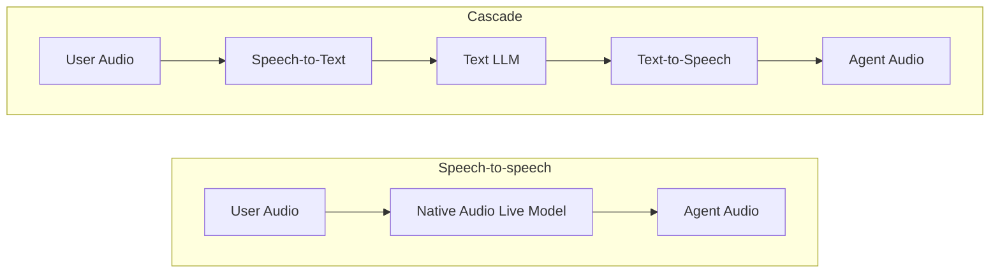

# Choose a voice architecture

<div class="language-support-tag">
    <span class="lst-supported">Supported in ADK</span><span class="lst-python">Python v2.13.0</span><span class="lst-java">Java v0.2.0</span>
</div>

ADK supports two voice architectures under `Runner.run_live()`:

- **[Speech-to-speech](speech-to-speech.md)**: A single native audio model processes speech input, reasoning, and speech output end to end over the Gemini Live API. Best when lowest latency, vocal emotion, or live video input matter most.
- **[Cascade](cascade.md)**: Chains speech-to-text (STT), any text-reasoning LLM, and text-to-speech (TTS) in sequence. Best when frontier text reasoning, modular speech providers, or pre-synthesis text guardrails matter most.

Both architectures use the same ADK runtime. Your session loop, request queue, event stream, tools, callbacks, and workflows stay identical, and switching architectures only changes the `model` on your agent:

=== "Speech-to-speech"

    ```python
    from google.adk.agents import Agent

    root_agent = Agent(
        name="voice_assistant",
        model="gemini-live-2.5-flash-native-audio",
        instruction="You are a helpful voice assistant.",
        tools=[...],
    )
    ```

=== "Cascade"

    ```python
    from google.adk.agents import Agent
    from google.adk.live import CascadeLive, GeminiSTT, GeminiTTS

    root_agent = Agent(
        name="voice_assistant",
        model=CascadeLive(
            model="gemini-3.8-flash",
            stt=GeminiSTT(),
            tts=GeminiTTS(speech_config="Kore"),
        ),
        instruction="You are a helpful voice assistant.",
        tools=[...],
    )
    ```

## Architecture comparison



| Dimension | Speech-to-speech | Cascade |
| :--- | :--- | :--- |
| **End-to-end latency** | Lowest (single model pass) | Moderate (serial stages overlapped via streaming and sentence prefetching) |
| **Reasoning model** | Native audio Live models only ([Supported models](../models.md)) | Any text LLM (Gemini Flash, Gemini Pro, or third-party models) |
| **Speech providers** | Built-in Gemini Live voices | Modular (Gemini, ElevenLabs, or custom STT/TTS providers) |
| **Vocal nuance** | Hears tone and emotion directly; native prosody | STT converts speech to text; TTS synthesizes sentence by sentence |
| **Video input** | Supported (live camera and screen frames) | Not supported (audio and text only) |
| **Text guardrails** | Screens transcriptions alongside audio generation | Full text boundary between stages; can inspect or modify text before synthesis |
| **Text-only execution (`run_async`)** | Not supported | Supported (uses the inner text LLM directly) |
| **SDK support** | Python, Java | Python (Experimental) |
