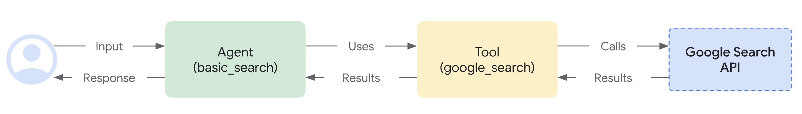

# Build live streaming agent with Go

<div class="language-support-tag">
  <span class="lst-supported">Supported in ADK</span><span class="lst-go">Go v2.0.0</span>
</div>

With this quickstart, you learn how to build a Go agent using Agent Development Kit (ADK) for bidirectional voice and video communication over the Gemini Live API. You install ADK Go, create a Google Search agent, and test live streaming in the ADK web interface.

!!! note "Prerequisites"
    Make sure you have Go 1.26.10 or higher installed and experience using a terminal on macOS, Linux, or Windows.

## Supported models for voice and video streaming {#supported-models}

Voice and video streaming requires a Gemini model that supports the Gemini Live API. Find the model IDs that support live streaming in the documentation:

- [Supported models for live agents](../models.md)
- [Google AI Studio: Gemini Live API](https://ai.google.dev/gemini-api/docs/models#live-api)
- [Agent Platform: Gemini Live API](https://docs.cloud.google.com/gemini-enterprise-agent-platform/models/live-api)

!!! note "Model support versions"
    Gemini 3.8 Live and Gemini 3.x Live models on Agent Platform require `google.golang.org/adk/v2` v2.8.0 or later. Running `go get google.golang.org/adk/v2` installs the latest release.

## Set up your environment and install ADK Go {#setup-environment-install-adk}

Create a project directory and initialize a Go module:

```bash
mkdir -p adk-streaming/app
cd adk-streaming/app
go mod init adk-streaming
```

Add ADK Go v2 as a dependency:

```bash
go get google.golang.org/adk/v2
```

## Project structure {#project-structure}

Create the following files in your `adk-streaming/` project directory:

```console
adk-streaming/          # Project folder
└── app/                # Application folder
    ├── .env            # Environment variables (API key or Google Cloud project)
    ├── go.mod          # Go module definition
    └── agent.go        # Agent definition and web launcher
```

### `agent.go`

Add the following code to `adk-streaming/app/agent.go`.

For the model name passed to `gemini.NewModel`, enter a model ID that supports the Gemini Live API from [Supported models for voice and video streaming](#supported-models).

```go title="app/agent.go"
package main

import (
	"context"
	"log"
	"os"

	"google.golang.org/adk/v2/agent"
	"google.golang.org/adk/v2/agent/llmagent"
	"google.golang.org/adk/v2/cmd/launcher"
	"google.golang.org/adk/v2/cmd/launcher/full"
	"google.golang.org/adk/v2/model/gemini"
	"google.golang.org/adk/v2/tool"
	"google.golang.org/adk/v2/tool/geminitool"
	"google.golang.org/genai"
)

func main() {
	ctx := context.Background()

	// Fill in the latest model ID that supports the Gemini Live API from:
	// https://adk.dev/live/get-started/streaming-go/#supported-models
	model, err := gemini.NewModel(ctx, "...", &genai.ClientConfig{})
	if err != nil {
		log.Fatalf("Failed to create model: %v", err)
	}

	rootAgent, err := llmagent.New(llmagent.Config{
		// A unique name for the agent.
		Name: "basic_search_agent",
		// The LLM that the agent uses.
		Model: model,
		// A short description of the agent's purpose.
		Description: "Agent to answer questions using Google Search.",
		// Instructions to set the agent's behavior.
		Instruction: "You are an expert researcher. You always stick to the facts.",
		// Add the GoogleSearch tool to ground responses with Google Search.
		Tools: []tool.Tool{
			geminitool.GoogleSearch{},
		},
	})
	if err != nil {
		log.Fatalf("Failed to create agent: %v", err)
	}

	config := &launcher.Config{
		AgentLoader: agent.NewSingleLoader(rootAgent),
	}

	l := full.NewLauncher()
	if err := l.Execute(ctx, config, os.Args[1:]); err != nil {
		log.Fatalf("Run failed: %v\n\n%s", err, l.CommandLineSyntax())
	}
}
```

The `agent.go` file defines the agent and wires it to the ADK launcher so you can run the ADK web interface directly from the command line. Leaving `&genai.ClientConfig{}` empty lets `google.golang.org/genai` read the backend and credentials from your environment variables, so the same code works with both Google AI Studio and Google Cloud Agent Platform.

The `llmagent.New` constructor and `geminitool.GoogleSearch{}` tool handle interactions with the LLM and [grounding with Google Search](https://ai.google.dev/gemini-api/docs/grounding?lang=go#configure-search), so you can focus on the agent's purpose and behavior.



Resolve the module dependencies from `adk-streaming/app/`:

```bash
go mod tidy
```

## Set up the platform {#set-up-the-platform}

To run the agent, choose a platform from either Google AI Studio or Google Cloud Agent Platform:

=== "Gemini - Google AI Studio"
    1. Get an API key from [Google AI Studio](https://aistudio.google.com/apikey).
    2. On macOS or Linux, create an `.env` file in `adk-streaming/app/` (do not commit `.env` to source control) and add the following variables. On Windows, set these variables in PowerShell in the next section instead.

        ```bash title="app/.env"
        export GOOGLE_GENAI_USE_ENTERPRISE=FALSE
        export GOOGLE_API_KEY="PASTE_YOUR_ACTUAL_API_KEY_HERE"
        ```

    3. Replace `PASTE_YOUR_ACTUAL_API_KEY_HERE` with your actual API key.

=== "Gemini - Google Cloud Agent Platform"
    1. Set up an existing [Google Cloud](https://cloud.google.com/) account and project:
        * Set up a [Google Cloud project](https://docs.cloud.google.com/gemini-enterprise-agent-platform/models/start).
        * Install the [gcloud CLI](https://docs.cloud.google.com/gemini-enterprise-agent-platform/models/start).
        * Authenticate using Application Default Credentials by running `gcloud auth application-default login`.
        * [Enable the Agent Platform API](https://console.cloud.google.com/flows/enableapi?apiid=aiplatform.googleapis.com).
    2. On macOS or Linux, create an `.env` file in `adk-streaming/app/` (do not commit `.env` to source control), add the following variables, and update the project ID and regional location. On Windows, set these variables in PowerShell in the next section instead.

        ```bash title="app/.env"
        export GOOGLE_GENAI_USE_ENTERPRISE=TRUE
        export GOOGLE_CLOUD_PROJECT="PASTE_YOUR_ACTUAL_PROJECT_ID"
        export GOOGLE_CLOUD_LOCATION="us-central1"
        ```

For more information on connecting to Google Cloud from ADK agents, see [Connect to Google Cloud and Agent Platform](../../get-started/google-cloud.md).

## Try the agent with ADK Web {#try-the-agent-with-adk-web}

Load your environment variables and launch ADK Web from the `adk-streaming/app/` directory.

=== "macOS & Linux"
    ```bash
    source .env
    go run agent.go web api webui
    ```

=== "Windows PowerShell"
    ```powershell
    # Google AI Studio:
    $env:GOOGLE_GENAI_USE_ENTERPRISE = "FALSE"
    $env:GOOGLE_API_KEY = "PASTE_YOUR_ACTUAL_API_KEY_HERE"

    # Or Google Cloud Agent Platform:
    # $env:GOOGLE_GENAI_USE_ENTERPRISE = "TRUE"
    # $env:GOOGLE_CLOUD_PROJECT = "PASTE_YOUR_ACTUAL_PROJECT_ID"
    # $env:GOOGLE_CLOUD_LOCATION = "us-central1"

    go run agent.go web api webui
    ```

!!! warning "Caution: ADK Web for development only"

    ADK Web is ***not meant for use in production deployments***. Use ADK Web for development and debugging purposes only.

Open the URL printed in your terminal (`http://localhost:8080`, which redirects to `http://localhost:8080/ui/`) directly in your browser. The ADK Web server runs locally on `localhost`. Select `basic_search_agent`.

### Try with voice and video

To try with voice, reload the browser tab, click the microphone button to enable voice input, and ask the following questions aloud. The agent calls the `geminitool.GoogleSearch` tool to retrieve current information and responds with streaming voice audio.

* What is the weather in New York?
* What is the time in New York?
* What is the weather in Paris?
* What is the time in Paris?

To try with video, reload the browser tab, click the camera button to enable video input, and ask questions such as "What do you see?". The agent describes what appears in the video stream.

#### Caveat

- You cannot use text chat with native-audio models. Entering text messages in ADK Web returns errors when a native-audio model is configured.

### Stop the server

Stop ADK Web by pressing `Ctrl-C` in the terminal.

You have built and run your first live streaming agent with ADK Go.

## Next steps: build a custom streaming app

To build a custom Go web server that connects WebSocket clients to your live agent with `controllers.RuntimeAPIController` and `RunLiveHandler` or `Runner.RunLive`, see the [ADK Go bidirectional streaming example](https://github.com/google/adk-go/tree/main/examples/bidi). To learn more about live agent concepts, see [Sessions](../sessions.md), [Events](../events.md), and [Build a custom server](../custom-server.md).
