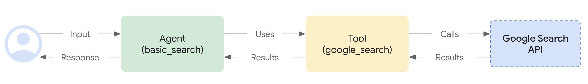

# Build a live streaming agent with Kotlin

<div class="language-support-tag">
    <span class="lst-supported">Supported in ADK</span><span class="lst-kotlin">Kotlin v1.6.0</span><span class="lst-preview">Experimental</span>
</div>

!!! example "Experimental:"
    The live streaming API in ADK Kotlin is an experimental release. It may
    change without notice and is not recommended for production use.

In this quickstart, you build a live streaming agent with Agent Development Kit
(ADK) Kotlin and hold a real-time, bidirectional voice and video conversation
with it. You set up a Gradle project, define a Google Search agent with
`GoogleSearchTool`, and run the agent in the ADK web interface with
`AdkDevServer`.

**Note:** This guide assumes you have experience using a terminal in Windows,
macOS, or Linux environments.

## Supported models for voice and video streaming {#supported-models}

Voice and video streaming requires a Gemini model that supports the Live API.
Find the supported **model IDs** in the documentation:

- [Supported models for live agents](../models.md)
- [Google AI Studio: Gemini Live API](https://ai.google.dev/gemini-api/docs/models#live-api)
- [Google Cloud Agent Platform: Gemini Live API](https://docs.cloud.google.com/gemini-enterprise-agent-platform/models/live-api)

## Set up your environment and install ADK {#setup-environment-install-adk}

Before you start, verify that you have the following tools installed:

- Java 17 or later
- Gradle 8.0 or later

Gradle downloads the required ADK Kotlin dependencies,
`com.google.adk:google-adk-kotlin-core` and
`com.google.adk:google-adk-kotlin-webserver`, when you configure
`build.gradle.kts` in the next section.

## Project structure {#project-structure}

Create a project directory with the following files:

```console
adk-streaming/
├── build.gradle.kts
├── .env
└── src/
    └── main/
        └── kotlin/
            └── com/
                └── example/
                    └── streaming/
                        ├── SearchAgent.kt
                        └── Main.kt
```

### build.gradle.kts

Copy the following configuration into `build.gradle.kts`:

```kotlin title="adk-streaming/build.gradle.kts"
plugins {
    kotlin("jvm") version "2.1.20"
    application
}

repositories {
    mavenCentral()
}

dependencies {
    implementation("com.google.adk:google-adk-kotlin-core:1.6.0")
    implementation("com.google.adk:google-adk-kotlin-webserver:1.6.0")
}

kotlin {
    jvmToolchain(17)
}

application {
    mainClass.set("com.example.streaming.MainKt")
}
```

### SearchAgent.kt

Copy the following code into `SearchAgent.kt`.

For `modelName`, verify the latest model ID that supports the Live API in
[Supported models for voice and video streaming](#supported-models).

```kotlin title="adk-streaming/src/main/kotlin/com/example/streaming/SearchAgent.kt"
package com.example.streaming

import com.google.adk.kt.agents.Instruction
import com.google.adk.kt.agents.LlmAgent
import com.google.adk.kt.models.Gemini
import com.google.adk.kt.models.VertexCredentials
import com.google.adk.kt.tools.GoogleSearchTool

object SearchAgent {
    private val modelName =
        System.getenv("DEMO_AGENT_MODEL")
            ?.takeUnless { it.isBlank() }
            ?: "gemini-3.8-live"

    private val model =
        if (System.getenv("GOOGLE_GENAI_USE_ENTERPRISE").equals("TRUE", ignoreCase = true)) {
            val location =
                System.getenv("GOOGLE_CLOUD_LOCATION")
                    ?.takeUnless { it.isBlank() }
                    ?: "us-central1"
            Gemini(
                name = modelName,
                vertexCredentials = VertexCredentials(location = location),
            )
        } else {
            Gemini(name = modelName)
        }

    val rootAgent = LlmAgent(
        // A unique name for the agent.
        name = "basic_search_agent",
        // The Large Language Model (LLM) that the agent uses.
        model = model,
        // A short description of the agent's purpose.
        description = "Agent to answer questions using Google Search.",
        // Instructions to set the agent's behavior.
        instruction = Instruction(
            "You are an expert researcher. You always stick to the facts."
        ),
        // Add GoogleSearchTool to perform grounding with Google Search.
        tools = listOf(GoogleSearchTool()),
    )
}
```

The `LlmAgent` class and `GoogleSearchTool` manage the model connection and
[grounding with Google Search](https://ai.google.dev/gemini-api/docs/grounding#configure-search),
so you can focus on the agent's purpose and instructions.



### Main.kt

Copy the following code into `Main.kt` to serve the agent and the bundled ADK
Web interface on localhost:

```kotlin title="adk-streaming/src/main/kotlin/com/example/streaming/Main.kt"
package com.example.streaming

import com.google.adk.kt.webserver.AdkServerConfig
import com.google.adk.kt.webserver.dev.AdkDevServer

fun main() {
    val server = AdkDevServer(AdkServerConfig.inMemory(SearchAgent.rootAgent))
    println("Serving basic_search_agent at http://localhost:8080/dev-ui")
    server.start(wait = true)
}
```

## Set up the platform {#set-up-the-platform}

Choose either Google AI Studio or Google Cloud Agent Platform to run the agent:

=== "Gemini - Google AI Studio"
    1. Get an API key from [Google AI Studio](https://aistudio.google.com/apikey).
    2. Open the **`.env`** file, or create **`.env.ps1`** on Windows
       PowerShell, in `adk-streaming/` and add the following environment
       variables. Do not commit this file to source control:

        === "macOS / Linux"

            ```bash title=".env"
            export GOOGLE_GENAI_USE_ENTERPRISE=FALSE
            export GOOGLE_API_KEY="PASTE_YOUR_ACTUAL_API_KEY_HERE"
            export DEMO_AGENT_MODEL="gemini-3.8-live"
            ```

        === "Windows PowerShell"

            ```powershell title=".env.ps1"
            $env:GOOGLE_GENAI_USE_ENTERPRISE = "FALSE"
            $env:GOOGLE_API_KEY = "PASTE_YOUR_ACTUAL_API_KEY_HERE"
            $env:DEMO_AGENT_MODEL = "gemini-3.8-live"
            ```

    3. Replace `PASTE_YOUR_ACTUAL_API_KEY_HERE` with your actual API key.

=== "Gemini - Google Cloud Agent Platform"
    1. Prepare a Google Cloud account and project:
        * Set up a
          [Google Cloud project](https://docs.cloud.google.com/gemini-enterprise-agent-platform/models/start).
        * Install the
          [gcloud CLI](https://docs.cloud.google.com/gemini-enterprise-agent-platform/models/start).
        * Authenticate using Application Default Credentials from the terminal
          by running `gcloud auth application-default login`.
        * [Enable the Agent Platform API](https://console.cloud.google.com/flows/enableapi?apiid=aiplatform.googleapis.com).
    2. Open the **`.env`** file, or create **`.env.ps1`** on Windows
       PowerShell, in `adk-streaming/`, add the following environment
       variables, and update the project ID and regional location. Do not commit
       this file to source control:

        === "macOS / Linux"

            ```bash title=".env"
            export GOOGLE_GENAI_USE_ENTERPRISE=TRUE
            export GOOGLE_CLOUD_PROJECT="PASTE_YOUR_ACTUAL_PROJECT_ID"
            export GOOGLE_CLOUD_LOCATION="us-central1"
            export DEMO_AGENT_MODEL="gemini-3.8-live"
            ```

        === "Windows PowerShell"

            ```powershell title=".env.ps1"
            $env:GOOGLE_GENAI_USE_ENTERPRISE = "TRUE"
            $env:GOOGLE_CLOUD_PROJECT = "PASTE_YOUR_ACTUAL_PROJECT_ID"
            $env:GOOGLE_CLOUD_LOCATION = "us-central1"
            $env:DEMO_AGENT_MODEL = "gemini-3.8-live"
            ```

        Live API models require a regional endpoint such as `us-central1`, not
        the `global` endpoint.

For more information on connecting to Google Cloud from ADK agents, see
[Connect to Google Cloud and Agent Platform](../../get-started/google-cloud.md).

## Try the agent with ADK Web {#try-the-agent-with-adk-web}

Load your environment variables and start `AdkDevServer` from the
`adk-streaming/` project directory:

=== "macOS / Linux"

    ```bash
    source .env
    gradle run
    ```

=== "Windows PowerShell"

    ```powershell
    . .\.env.ps1
    gradle run
    ```

!!! warning "Caution: ADK Web for development only"

    ADK Web is ***not meant for use in production deployments***. Use
    `AdkDevServer` and ADK Web for development and debugging purposes only.

Open `http://localhost:8080/dev-ui` directly in your browser. This connection
stays on your local machine. Select `basic_search_agent` from the agent menu.

### Try with voice and video

To try with voice, reload the browser page, click the microphone button to
enable voice input, and ask the following questions aloud. The agent uses
`GoogleSearchTool` to retrieve current information and responds in real-time
audio.

* What is the weather in New York?
* What is the time in New York?
* What is the weather in Paris?
* What is the time in Paris?

To try with video, reload the browser page, click the camera button to enable
video input, and ask a question such as "What do you see?". The agent describes
what appears in the video feed.

#### Caveat

- Do not use the text chat input box with native-audio Live models. Typing a
  message in ADK Web sends a non-live request to `/run_sse`, which live-only
  models reject.

### Stop the server

Stop the server by pressing `Ctrl-C` in the terminal.

## Next steps: build a custom streaming application

To build a custom live streaming application in ADK Kotlin, call
`runner.runLive()` with a `LiveRequestQueue` and a `RunConfig` that carries
your `LiveRunConfig` settings (`RunConfig(live = LiveRunConfig(...))`, opted in
with `@OptIn(ExperimentalLiveApi::class)`). For a complete Kotlin microphone
and speaker example, see
[`LiveAgentDemo.kt`](https://github.com/google/adk-kotlin/blob/main/examples/src/main/kotlin/com/google/adk/kt/examples/live/LiveAgentDemo.kt)
in the `google/adk-kotlin` repository.

To learn more about live agent concepts and server design, see the following
guides, which show Python examples for the same runner and lifecycle patterns:

- [Sessions](../sessions.md) covers the live application lifecycle and session
  resumption.
- [Events](../events.md) describes the events returned by live runs.
- [Build a custom server](../custom-server.md) walks through bridging a
  WebSocket client to a live agent runner.
