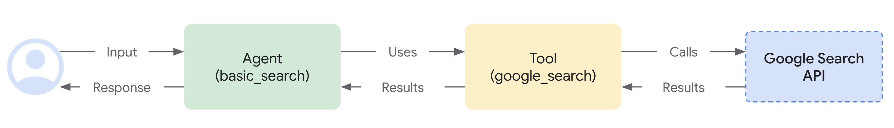

# Build a live streaming agent with ADK TypeScript

<div class="language-support-tag">
  <span class="lst-supported">Supported in ADK</span><span class="lst-typescript">TypeScript v2.3.0</span><span class="lst-preview">Experimental</span>
</div>

!!! example "Experimental:"
    Live streaming in ADK TypeScript is an experimental release.
    It may have limitations and is not recommended for production use.

In this quickstart, you create an agent with Agent Development Kit (ADK) and
enable bidirectional voice and video streaming in ADK TypeScript. You install
ADK TypeScript, define a Google Search agent, and test live audio and video
interactions with the `adk web` command.

**Note:** This guide assumes you have experience using a terminal on macOS,
Linux, or Windows.

## Supported models for voice and video streaming { #supported-models }

Voice and video streaming requires a Gemini model that supports the Live API.
Review the [Supported models](../models.md) page and the following platform
lists to find the model ID for your backend:

-   [Google AI Studio: Gemini Live API](https://ai.google.dev/gemini-api/docs/models#live-api)
-   [Google Cloud Agent Platform: Gemini Live API](https://docs.cloud.google.com/gemini-enterprise-agent-platform/models/live-api)

## Set up your environment and install ADK { #setup-environment-install-adk }

Before you start, make sure you have the following installed:

-   Node.js 24.13.0 or later
-   Node Package Manager (npm) 11.8.0 or later

Create a project directory and navigate into it:

=== "macOS / Linux"

    ```bash
    mkdir -p adk-streaming/google_search_agent
    cd adk-streaming
    ```

=== "Windows CMD"

    ```console
    mkdir adk-streaming\google_search_agent
    cd adk-streaming
    ```

=== "Windows PowerShell"

    ```powershell
    New-Item -ItemType Directory -Force -Path adk-streaming/google_search_agent
    cd adk-streaming
    ```

Initialize an ES module package and install the ADK TypeScript packages:

```bash
npm init --yes
npm pkg set type="module"
npm install @google/adk
npm install -D @google/adk-devtools
```

## Project structure { #project-structure }

Create the `.env` and `google_search_agent/agent.ts` files so your project
matches the following folder structure:

```console
adk-streaming/
├── .env
├── package.json
└── google_search_agent/
    └── agent.ts
```

### Define the agent

Copy the following code into `google_search_agent/agent.ts`. Replace the
`model` placeholder with a model ID from the
[Supported models](#supported-models) section.

```typescript title="adk-streaming/google_search_agent/agent.ts"
import {GOOGLE_SEARCH, LlmAgent} from '@google/adk';

export const rootAgent = new LlmAgent({
  // A unique name for the agent.
  name: 'basic_search_agent',
  // The Large Language Model (LLM) that the agent uses.
  // Fill in a model ID that supports the Live API from
  // https://adk.dev/live/get-started/streaming-typescript/#supported-models
  model: '...',
  // A short description of the agent's purpose.
  description: 'Agent to answer questions using Google Search.',
  // Instructions to set the agent's behavior.
  instruction: 'You are an expert researcher. You always stick to the facts.',
  // Add GOOGLE_SEARCH to perform grounding with Google Search.
  tools: [GOOGLE_SEARCH],
});
```

Your `agent.ts` file holds the agent logic and exports `rootAgent`, which ADK
Web loads automatically.

The `LlmAgent` class and the `GOOGLE_SEARCH` tool connect the agent to the LLM
and [grounding with Google Search](../../grounding/google_search_grounding.md)
so you can focus on the agent's purpose and instructions.



## Set up the platform { #set-up-the-platform }

Choose either Google AI Studio or Google Cloud Agent Platform to run the agent:

=== "Gemini - Google AI Studio"
    1.  Get an API key from [Google AI Studio](https://aistudio.google.com/apikey).
    2.  Open the `.env` file in the `adk-streaming/` directory and add the
        following variables:

        ```env title=".env"
        GOOGLE_GENAI_USE_ENTERPRISE=FALSE
        GEMINI_API_KEY=PASTE_YOUR_ACTUAL_API_KEY_HERE
        ```

    3.  Replace `PASTE_YOUR_ACTUAL_API_KEY_HERE` with your actual API key.

=== "Gemini - Google Cloud Agent Platform"
    1.  Prepare an existing [Google Cloud](https://cloud.google.com/?e=48754805&hl=en)
        account and project:
        -   Set up a
            [Google Cloud project](https://docs.cloud.google.com/gemini-enterprise-agent-platform/models/start).
        -   Install and initialize the
            [gcloud CLI](https://docs.cloud.google.com/gemini-enterprise-agent-platform/models/start).
        -   Authenticate to Google Cloud from your terminal by running
            `gcloud auth application-default login`.
        -   [Enable the Agent Platform API](https://console.cloud.google.com/flows/enableapi?apiid=aiplatform.googleapis.com).
    2.  Open the `.env` file in the `adk-streaming/` directory, add the
        following variables, and update the project ID and location:

        ```env title=".env"
        GOOGLE_GENAI_USE_ENTERPRISE=TRUE
        GOOGLE_CLOUD_PROJECT=PASTE_YOUR_ACTUAL_PROJECT_ID
        GOOGLE_CLOUD_LOCATION=us-central1
        ```

For more information on connecting to Google Cloud from ADK agents, see
[Connect to Google Cloud and Agent Platform](../../get-started/google-cloud.md).

## Try the agent with ADK Web { #try-the-agent-with-adk-web }

From the `adk-streaming/` directory, run the following command to launch ADK
Web:

```bash
npx adk web
```

!!! warning "Caution: ADK Web for development only"

    ADK Web is ***not meant for use in production deployments***. You should
    use ADK Web for development and debugging purposes only.

Open `http://localhost:8000` directly in your browser. Your browser connects to
the local server on your machine. Select `google_search_agent` from the agent
dropdown.

### Try with voice and video

To test voice streaming, reload the browser tab, click the microphone button to
enable voice input, and ask the following questions aloud. The agent uses
`GOOGLE_SEARCH` to retrieve current information and responds in voice in real
time:

-   What is the weather in New York?
-   What is the time in New York?
-   What is the weather in Paris?
-   What is the time in Paris?

To test video streaming, reload the browser tab, click the camera button to
enable video input, and ask a question such as "What do you see?". The agent
describes what it sees in the video stream.

#### Caveat

-   You cannot use text chat with native audio models. Sending text messages in
    ADK Web with a native audio model returns an error.

### Stop ADK Web

Stop `npx adk web` by pressing `Ctrl-C` in the terminal.

## Next steps

Explore the rest of the live agent guides for live streaming concepts and
architecture. These guides currently show Python examples; see the
[TypeScript API reference](https://adk.dev/api-reference/typescript/) for the
`LiveRequestQueue`, `Runner.runLive()`, and `RunConfig` options supported in
ADK TypeScript:

-   [Configuration](../configuration.md) covers voice selection, transcription,
    and turn detection.
-   [Sessions](../sessions.md) and [Events](../events.md) explain the live
    streaming lifecycle and event stream.
-   [Build a custom server](../custom-server.md) walks through running a live
    agent behind your own server and client instead of ADK Web.
