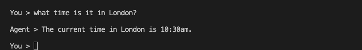

# Use the Command Line

<div class="language-support-tag">
  <span class="lst-supported">Supported in ADK</span><span class="lst-python">Python v0.1.0</span><span class="lst-typescript">TypeScript v0.2.0</span><span class="lst-go">Go v0.1.0</span><span class="lst-java">Java v0.1.0</span>
</div>

ADK provides an interactive terminal interface for testing your agents. This is
useful for quick testing, scripted interactions, and CI/CD pipelines.



## Run an agent

Use the following command to run your agent in the ADK command line interface:

=== "Python"

    ```shell
    adk run my_agent
    ```

=== "TypeScript"

    ```shell
    npx @google/adk-devtools run agent.ts
    ```

=== "Go"

    In Go, the command-line interface is not a standalone `adk` tool. Instead,
    you embed the launcher directly in your agent's `main.go`. The
    `full.NewLauncher()` helper bundles the console, web server, and other
    modes into a single binary, with **console as the default** when no
    subcommand keyword is given:

    ```go title="main.go"
    import (
        "google.golang.org/adk/v2/cmd/launcher"
        "google.golang.org/adk/v2/cmd/launcher/full"
    )

    func main() {
        // ... build your agent and config ...
        l := full.NewLauncher()
        if err := l.Execute(ctx, config, os.Args[1:]); err != nil {
            log.Fatalf("Run failed: %v\n\n%s", err, l.CommandLineSyntax())
        }
    }
    ```

    Run the agent in console mode with either of the following commands:

    ```shell
    go run agent.go           # console is the default sublauncher
    go run agent.go console   # or explicitly name the console subcommand
    ```

    `full.NewLauncher()` is meant for development. To choose which modes a
    binary offers, for example to leave the console and the development web
    UI out of a production build, see
    [Choose the launcher modes in Go](#choose-the-launcher-modes-in-go).

=== "Java"

    Create an `AgentCliRunner` class (see [Java Quickstart](../get-started/java.md)) and run:

    ```shell
    mvn compile exec:java -Dexec.mainClass="com.example.agent.AgentCliRunner"
    ```

This starts an interactive session where you can type queries and see agent
responses directly in your terminal.

=== "Python"

    ```shell
    Running agent my_agent, type exit to exit.
    [user]: What's the weather in New York?
    [my_agent]: The weather in New York is sunny with a temperature of 25°C.
    [user]: exit
    ```

=== "TypeScript"

    ```shell
    Running agent my_agent, type exit to exit.
    [user]: What's the weather in New York?
    [my_agent]: The weather in New York is sunny with a temperature of 25°C.
    [user]: exit
    ```

=== "Go"

    ```shell
    User -> What's the weather in New York?

    Agent -> The weather in New York is sunny with a temperature of 25°C.

    User ->
    ```

    To exit, press **Ctrl+C** or send EOF (**Ctrl+D**).

=== "Java"

    ```shell
    Running agent my_agent, type exit to exit.
    [user]: What's the weather in New York?
    [my_agent]: The weather in New York is sunny with a temperature of 25°C.
    [user]: exit
    ```

## Choose the launcher modes in Go

<div class="language-support-tag">
  <span class="lst-supported">Supported in ADK</span><span class="lst-go">Go v0.1.0</span>
</div>

A Go agent binary offers the modes of the launcher that its `main` function
builds. ADK Go provides two ready-made launchers, and you can compose your own
from the same parts.

| Launcher | Modes it offers | Default when no mode is given |
|----------|-----------------|-------------------------------|
| `full.NewLauncher()` | `console`, and `web` with the `webui`, `a2a`, `pubsub`, `eventarc` and `api` sublaunchers | `console` |
| `prod.NewLauncher()` | `web` with the `api` and `a2a` sublaunchers only: no console and no development web UI | `web` |

### Run a production binary

A binary built with `full.NewLauncher()` ships the console and the development
web UI. For a deployed agent, use `prod.NewLauncher()` from
`google.golang.org/adk/v2/cmd/launcher/prod` instead:

```go
--8<-- "examples/go/snippets/runtime/launchers/prod/main.go:prod_launcher"
```

The `web` mode serves only the sublaunchers that you name on the command line,
and it does not start without at least one. Pass the web server flags first,
then the sublauncher keywords. Because `web` is the default mode of
`prod.NewLauncher()`, the `web` keyword itself is optional:

```shell
./agent -port 8080 api a2a       # REST API and A2A
./agent web -port 8080 api       # the same with the web keyword, REST API only
```

Started with no sublauncher keyword, the binary exits with
`no active sublaunchers found - please specify them in the command line`.
Modes that the launcher does not include are rejected, so `./agent console`
fails with `cannot parse following arguments: [console]`.

### Compose a launcher

To offer a different set of modes, build the launcher from sublaunchers:

- `universal.NewLauncher(sublaunchers...)`, from
  `google.golang.org/adk/v2/cmd/launcher/universal`, chooses one sublauncher by
  the first command-line argument, its keyword. When the first argument is not
  a keyword, or there are no arguments, it runs the **first** sublauncher passed
  to it.
- `web.NewLauncher(sublaunchers...)`, from
  `google.golang.org/adk/v2/cmd/launcher/web`, is the `web` mode. It runs one
  web server for the web sublaunchers that the command line names: `api`
  (`web/api`), `a2a` (`web/a2a`), `webui` (`web/webui`), `pubsub`
  (`web/triggers/pubsub`) and `eventarc` (`web/triggers/eventarc`).

The following launcher serves the REST API by default and keeps the console
available for local testing:

```go
--8<-- "examples/go/snippets/runtime/launchers/custom/main.go:custom_launcher"
```

```shell
./agent api        # the web mode, with the REST API
./agent console    # the console
```

`full.NewLauncher()` and `prod.NewLauncher()` are built the same way:
`full.NewLauncher()` is
`universal.NewLauncher(console.NewLauncher(), web.NewLauncher(webui.NewLauncher(), a2a.NewLauncher(), pubsub.NewLauncher(), eventarc.NewLauncher(), api.NewLauncher()))`,
and `prod.NewLauncher()` is
`universal.NewLauncher(web.NewLauncher(api.NewLauncher(), a2a.NewLauncher()))`.

### Add a custom mode

A custom mode implements one of two interfaces:

- [`launcher.SubLauncher`](https://pkg.go.dev/google.golang.org/adk/v2/cmd/launcher#SubLauncher),
  for a mode of `universal.NewLauncher()` such as `console`. It provides
  `Keyword`, `Parse`, `CommandLineSyntax`, `SimpleDescription` and `Run`.
- [`web.Sublauncher`](https://pkg.go.dev/google.golang.org/adk/v2/cmd/launcher/web#Sublauncher),
  for routes on the shared web server, such as `api`. Instead of `Run`, it
  provides `SetupSubrouters`, which adds its routes to the server's router, and
  `UserMessage`, which prints where to reach them when the server starts.

Each keyword must be unique within its launcher: `universal.NewLauncher()` and
`web.NewLauncher()` return an error at startup when two sublaunchers share one.

## Session options

!!! note "Python only"

    The `--save_session`, `--resume`, `--replay`, and `--session_id` options
    are available in the Python ADK CLI only. The Go console launcher does not
    support session save/resume/replay via command-line flags. In Go, session
    persistence is configured in code by providing a persistent
    `session.Service` implementation (such as `session/database`) to
    `launcher.Config`.

The `adk run` command includes options for saving, resuming, and replaying
sessions.

### Save sessions

To save the session when you exit:

```shell
adk run --save_session path/to/my_agent
```

You'll be prompted to enter a session ID, and the session will be saved to
`path/to/my_agent/<session_id>.session.json`.

You can also specify the session ID upfront:

```shell
adk run --save_session --session_id my_session path/to/my_agent
```

### Resume sessions

To continue a previously saved session:

```shell
adk run --resume path/to/my_agent/my_session.session.json path/to/my_agent
```

This loads the previous session state and event history, displays it, and allows
you to continue the conversation.

### Replay sessions

To replay a session file without interactive input:

```shell
adk run --replay path/to/input.json path/to/my_agent
```

The input file should contain initial state and queries:

```json
{
  "state": {"key": "value"},
  "queries": ["What is 2 + 2?", "What is the capital of France?"]
}
```

## Storage options

!!! note "Python only"

    The `--session_service_uri` and `--artifact_service_uri` command-line
    flags are available in the Python ADK CLI only. In Go, session and artifact
    services are configured in code when constructing `launcher.Config` — for
    example, using `session/database` for a persistent database-backed session
    store, or `artifact/gcsartifact` for Cloud Storage-backed artifacts.

| Option | Description | Default |
|--------|-------------|---------|
| `--session_service_uri` | Custom session storage URI | Per-agent SQLite at `<agents_dir>/<agent>/.adk/session.db` |
| `--artifact_service_uri` | Custom artifact storage URI | Per-agent directory at `<agents_dir>/<agent>/.adk/artifacts` |
| `--memory_service_uri` | Custom memory service URI | In-memory |

### Example with storage options

```shell
adk run --session_service_uri "sqlite:///my_sessions.db" path/to/my_agent
```

## All options

=== "Python"

    To send a single message and exit instead of starting an interactive
    session, pass the query as an argument:

    ```shell
    adk run path/to/my_agent "hello"
    ```

    | Option | Description |
    |--------|-------------|
    | `--save_session` | Save the session to a JSON file on exit |
    | `--session_id` | Session ID to use when saving |
    | `--resume` | Path to a saved session file to resume |
    | `--replay` | Path to an input file for non-interactive replay |
    | `--session_service_uri` | Custom session storage URI |
    | `--artifact_service_uri` | Custom artifact storage URI |
    | `--memory_service_uri` | Custom memory service URI |
    | `--use_local_storage/--no_use_local_storage` | Use the local `.adk` folder when no service URI is set |
    | `--state` | Initial state for the run as a JSON string |
    | `--timeout` | Timeout for a single turn or query, such as `30s` or `5m` |
    | `--in_memory` | Do not persist session data |
    | `--jsonl` | Output structured JSONL instead of human-readable text |
    | `--default_llm_model` | Default model when the agent does not set one |

=== "Go"

    !!! note "Go flags differ from Python"

        The Go console launcher does not support `--save_session`, `--resume`,
        `--replay`, `--session_id`, `--session_service_uri`, or
        `--artifact_service_uri`. These are Python CLI features. Session and
        artifact services are configured in Go code via `launcher.Config`.

    Flags are passed after the `console` keyword (or directly if `console` is
    the default):

    | Flag | Description | Default |
    |------|-------------|---------|
    | `-streaming_mode` | Streaming mode for agent responses (`none`\|`sse`) | Auto-detected (TTY → `sse`, pipe → `none`) |
    | `-shutdown-timeout` | Graceful shutdown wait time | `2s` |
    | `-otel_to_cloud` | Export OpenTelemetry data to GCP | `false` |

    For example, to force non-streaming output:

    ```shell
    go run agent.go console -streaming_mode none
    ```

    Or to force SSE streaming (token-by-token output):

    ```shell
    go run agent.go -streaming_mode sse
    ```

## Usage telemetry

The ADK CLI collects anonymous usage telemetry to understand feature adoption, guide development priorities, and improve tool performance. Data collection is OFF by default until you explicitly choose to enable it.

Your telemetry preference is stored locally on your machine in `~/.adk/config.json`. You can manage telemetry data collection at any time through the terminal:

- **Enable**: `adk telemetry enable`
- **Disable**: `adk telemetry disable`
- **Check status**: `adk telemetry status`

You can also manually deactivate telemetry data collection at any time by opening `~/.adk/config.json` and setting the `telemetry` attribute to `false`:

```json
{
  "telemetry": false
}
```

**What data is collected**

- **Environment Properties**: Operating system information, runtime language and version, and installed ADK CLI version.
- **Command Execution Events**: Generic command and subcommand names, flags passed, execution duration, exit codes, and exception types if an error occurs. We also log a sequence number and an ephemeral session ID that is discarded after command execution.

**What data is not collected**

The CLI does not collect sensitive, private, or personal data, specifically:

- Arguments or parameter values passed to commands or flags, such as agent names, prompt strings, file paths.
- User credentials, usernames, API keys, OAuth tokens, or secrets.
- Google Cloud Project IDs or Cloud Account details.
- Source code files, file contents, or directory paths.
- Personally Identifiable Information (PII).
