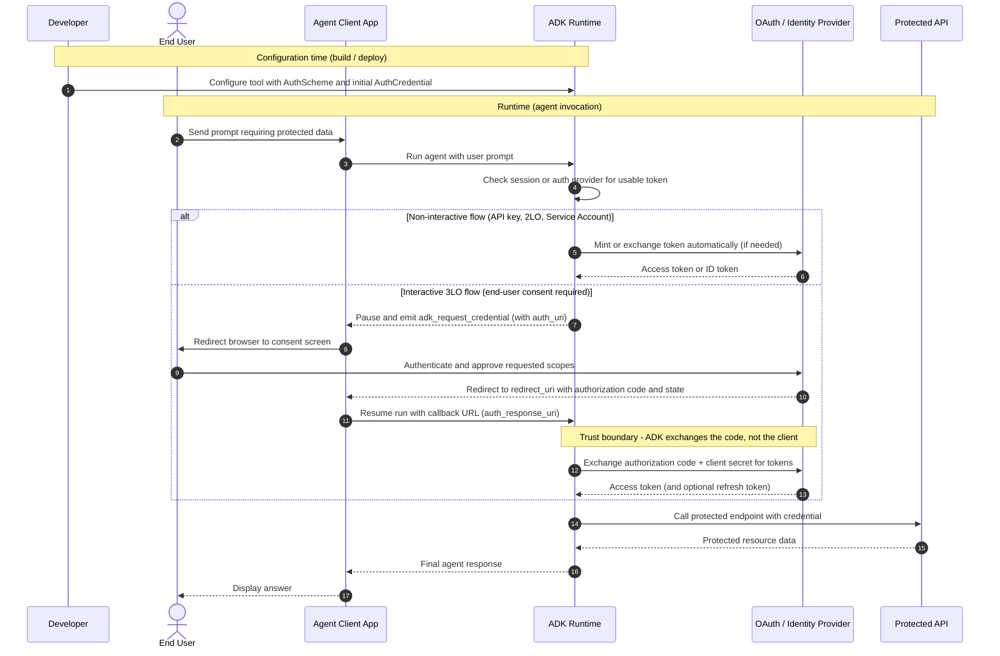
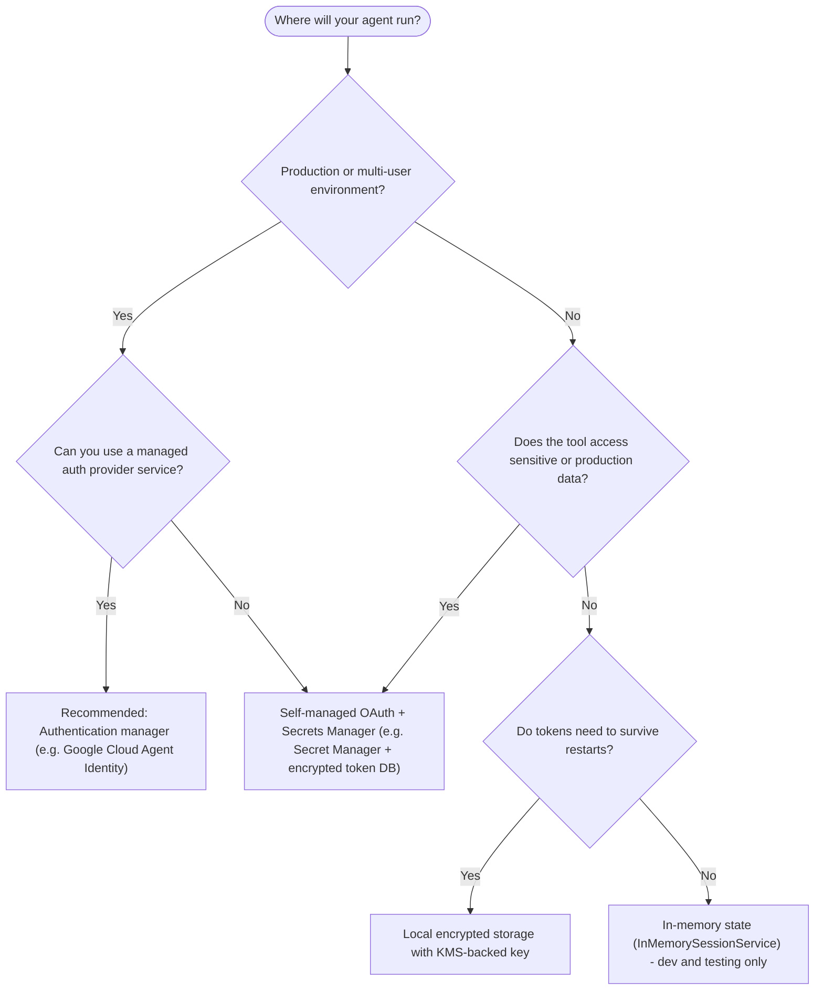
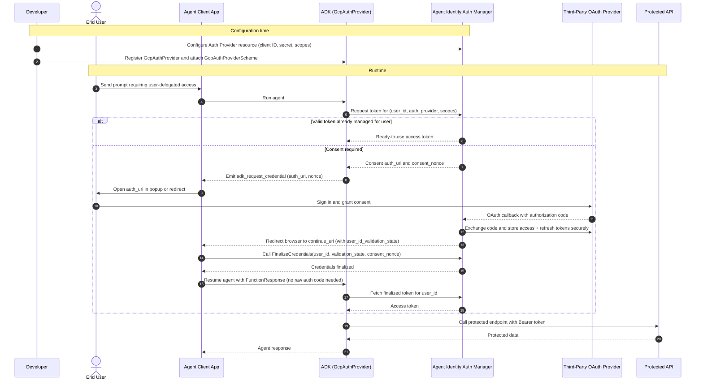
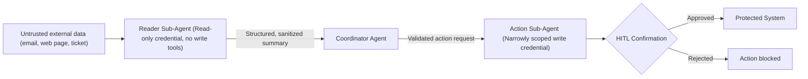
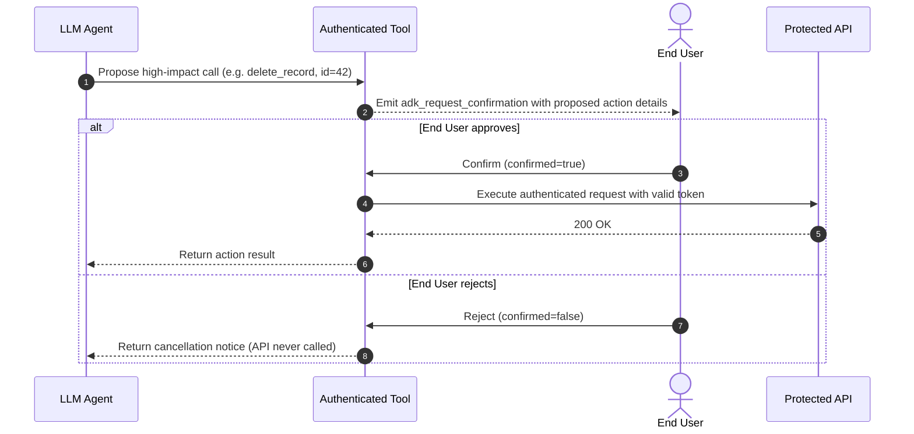
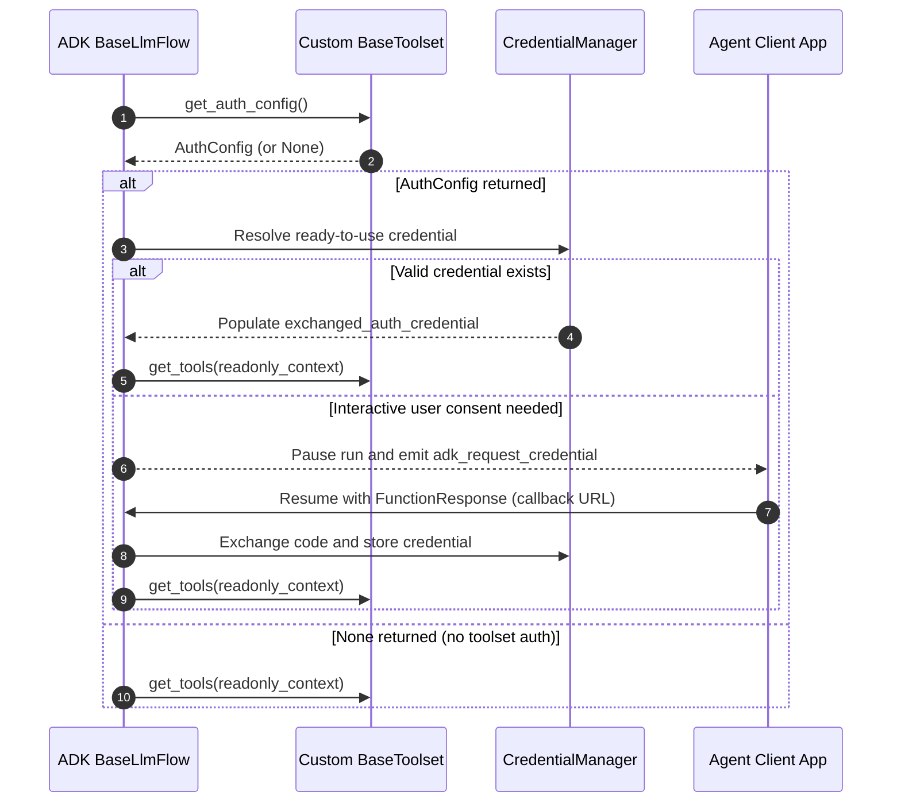
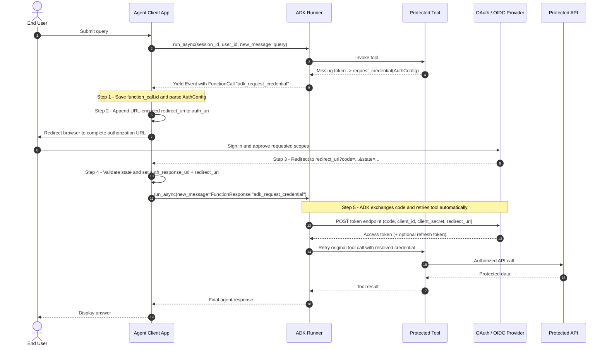
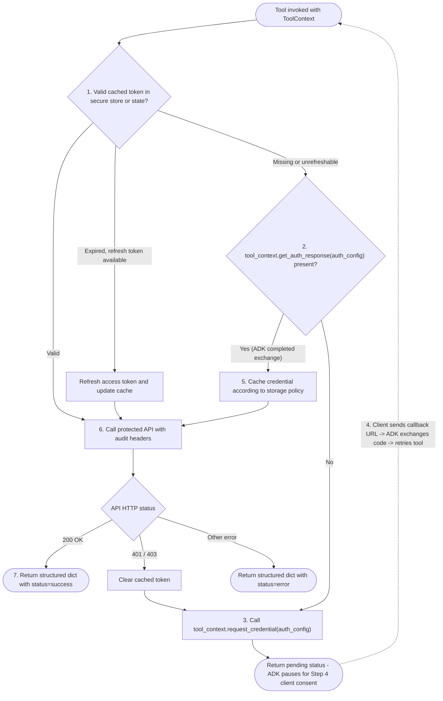
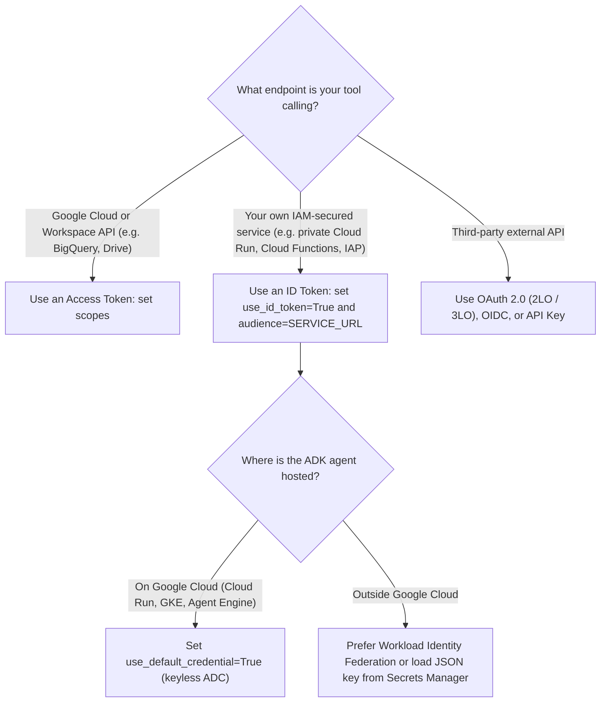

# Authentication and Agent Security

<div class="language-support-tag">
  <span class="lst-supported">Supported in ADK</span><span class="lst-python">Python v0.1.0</span><span class="lst-typescript">TypeScript v0.2.0</span><span class="lst-go">Go v0.3.0</span><span class="lst-kotlin">Kotlin v0.1.0 (Experimental)</span>
</div>

Agents frequently need tools that access protected APIs, databases, and user data. Unlike traditional deterministic software, an LLM-powered agent decides **which** tools to call, **when** to call them, and **what arguments** to pass—often while processing untrusted natural-language input. Because of this autonomy, authenticating an agent is both an **identity problem** and an **agentic security problem**.

This guide explains how authentication works in the Agent Development Kit (ADK), how to protect credentials and limit blast radius in production, and how to implement every supported identity flow step by step.

---

## Quick navigation: Find your implementation path {#quick-navigation}

Use this table to jump directly to the module that matches your task:

| I want to... | Recommended approach | Jump to |
| :--- | :--- | :--- |
| **Deploy an agent to production** without managing OAuth token storage myself | Managed auth provider (Google Cloud Agent Identity) | [Authentication manager services](#authentication-manager) |
| **Understand security risks** (prompt injection, token storage, destructive tools) | Least privilege, sub-agent isolation, HITL confirmation, audit logs | [Security first: Credential management & agentic risks](#security-first) |
| **Look up ADK auth classes** (`AuthConfig`, `AuthCredential`, `BaseAuthProvider`, etc.) | `google.adk.auth` / `@google/adk` / `adk/v2/auth` reference | [Core framework components](#framework-components) |
| **Act on behalf of a human user** (interactive login & consent) | 3-legged OAuth 2.0 (3LO) or OpenID Connect (OIDC) | [Module 4.1: Configure identity flows](#module-4-1-identity-flows) & [Module 4.4: Interactive 3LO flow](#module-4-4-interactive-flow) |
| **Authenticate machine-to-machine** (no human user in the loop) | 2-legged OAuth 2.0 (2LO) or Service Account / ADC | [Module 4.1: Configure identity flows](#module-4-1-identity-flows) |
| **Wrap a custom function with automatic auth** (minimal boilerplate) | `AuthenticatedFunctionTool` or custom `BaseAuthProvider` | [Module 4.2: Authenticated functions & custom providers](#module-4-2-custom-providers) |
| **Authenticate a whole group of tools at once** | `BaseToolset.get_auth_config()` | [Module 4.3: Toolset-level authentication](#module-4-3-toolset-auth) |
| **Write custom token-caching & retry logic** inside a tool | `FunctionTool` with `ToolContext` | [Module 4.5: Manual auth in a custom FunctionTool](#module-4-5-custom-function-tool) |
| **Call a private Cloud Run or IAM-secured service** | Google-signed ID Token (`use_id_token=True` + `audience`) | [Module 5.1: ID tokens vs. access tokens](#module-5-1-id-tokens) |
| **Reuse an access token already held by my frontend** | `external_access_token_key` in session state | [Module 5.2: External access tokens](#module-5-2-external-tokens) |
| **Validate API signatures & SDK behavior in source code** | Official ADK GitHub repositories (`Python`, `TS`, `Go`, `Kotlin`, `Java`) | [Reference repositories & source validation](#reference-repositories) |

---

## 1. Introduction to agent authentication {#introduction}

### Two distinct security principals

Every authenticated agent workflow involves up to two separate security principals. Keeping them distinct prevents privilege confusion when you design your system:

| Security principal | When they act | What they provide | Example |
| :--- | :--- | :--- | :--- |
| **Developer** | **Configuration time** (build / deploy) | Configures the tool's authentication scheme (`AuthScheme`) and the application's *initial* credential (`AuthCredential` or managed provider reference). | OAuth 2.0 `client_id` and `client_secret`, service account identity, or API key loaded from a secrets manager. |
| **End User** *(resource owner)* | **Runtime** (during a conversation) | Grants explicit consent for the agent to act on their behalf through an interactive OAuth 2.0 or OpenID Connect (OIDC) login flow. | Approving read-only access to their personal Google Calendar or Spotify playlists. |

### How ADK orchestrates authentication

When an agent decides to call a protected tool, ADK checks whether a valid credential is already available for the current session:

1. **Non-interactive flows (API keys, service accounts, 2LO client credentials):** ADK resolves or exchanges the credential automatically in the background and invokes the tool.
2. **Interactive flows (3LO OAuth 2.0 and OIDC):** ADK pauses tool execution and emits an `adk_request_credential` event containing an authorization URL (`auth_uri`). Your **Agent Client** application redirects the **End User** to sign in, captures the resulting OAuth callback URL, and passes that callback URL back to ADK. **ADK** (or your configured Authentication Manager) then exchanges the authorization code for tokens and automatically retries the tool.

**Workflow 1: End-to-end authenticated agent architecture and trust boundary**



!!! warning "Understand the token-exchange trust boundary"

    In ADK's native interactive OAuth flow, your **Agent Client** application **never** exchanges the authorization code or returns a "validated credential." The client returns the **OAuth callback URL** (`auth_response_uri`), and the **ADK backend** performs the token exchange with the OAuth provider so that `client_secret` and refresh tokens remain server-side.

---

## 2. Security first: Credential management & agentic risks {#security-first}

!!! danger "WARNING: Credential storage and session state risks"

    Storing sensitive credentials—especially long-lived **refresh tokens**, client secrets, or service account private keys—directly in session state (`tool_context.state`) introduces serious exfiltration risk if your `SessionService` backend is unencrypted, broadly readable, or logged. Always choose an appropriate credential storage strategy **before** moving an agent beyond local prototyping.

### Choose a credential management strategy

Use the decision matrix and flowchart below to pick the right storage architecture for your environment:

| Strategy | Best for | Where secrets & tokens live | Operational effort | Security risk |
| :--- | :--- | :--- | :--- | :--- |
| **[Authentication manager](#authentication-manager)** | **Production (Recommended)** | Managed cloud service stores client secrets, runs token exchange, refreshes tokens, and audits access. | Low | **Lowest** |
| **[Self-managed + secrets manager](#secrets-manager)** | Production when a managed auth service is unavailable | Client secrets and refresh tokens live in a dedicated Secrets Manager; only short-lived access tokens enter memory. | Medium–High | **Low–Medium** |
| **[Local encrypted storage](#local-encrypted)** | Single-host or internal lower-sensitivity apps | Encrypted local database with keys managed by a KMS; short-lived tokens in memory. | Medium | **Medium** |
| **[In-memory session state](#in-memory)** | **Local prototyping & unit tests only** | `InMemorySessionService` process memory (lost on restart). | Minimal | **High (Never use in prod)** |

**Workflow 2: Choosing a credential management strategy**



---

### Recommended: Authentication manager services {#authentication-manager}

For production deployments—especially multi-user applications where each user has different permissions—delegate credential lifecycle management to a dedicated **authentication manager** instead of writing custom token-refresh and persistence code.

On Google Cloud, ADK integrates natively with **[Google Cloud Agent Identity Auth Manager](/integrations/agent-identity/)** (`GcpAuthProvider` in Python, `auth/gcp` in Go). Agent Identity stores your OAuth client secrets or API keys, handles 2-legged (2LO) and 3-legged (3LO) OAuth exchanges, refreshes tokens automatically, and records access in Cloud Audit Logs.

=== "Python"

    Install the `agent-identity` extra:

    ```bash
    pip install "google-adk[agent-identity]"
    ```

    Register `GcpAuthProvider` once with `CredentialManager`, then attach `GcpAuthProviderScheme` to `AuthenticatedFunctionTool` or `McpToolset`:

    ```python
    import os
    from google.adk.agents import Agent
    from google.adk.auth import AuthConfig, AuthCredential
    from google.adk.auth.credential_manager import CredentialManager
    from google.adk.integrations.agent_identity import (
        GcpAuthProvider,
        GcpAuthProviderScheme,
    )
    from google.adk.tools.authenticated_function_tool import AuthenticatedFunctionTool
    from google.adk.tools.mcp_tool import McpToolset, StreamableHTTPConnectionParams

    # Register the Google Cloud Agent Identity provider once at startup
    CredentialManager.register_auth_provider(GcpAuthProvider())

    PROJECT = os.environ["GOOGLE_CLOUD_PROJECT"]
    LOCATION = os.environ["GOOGLE_CLOUD_LOCATION"]

    # 1. Machine-to-machine (2LO) auth provider
    search_auth_2lo = AuthConfig(
        auth_scheme=GcpAuthProviderScheme(
            name=f"projects/{PROJECT}/locations/{LOCATION}/authProviders/{os.environ['SPOTIFY_2LO_PROVIDER_ID']}"
        )
    )

    # 2. User-delegated (3LO) auth provider with least-privilege scope
    playlist_auth_3lo = AuthConfig(
        auth_scheme=GcpAuthProviderScheme(
            name=f"projects/{PROJECT}/locations/{LOCATION}/authProviders/{os.environ['SPOTIFY_3LO_PROVIDER_ID']}",
            scopes=["playlist-read-private"],
            continue_uri=os.environ["OAUTH_CONTINUE_URI"],  # Your app's finalize callback
        )
    )

    async def get_my_playlists(credential: AuthCredential) -> dict:
        """Fetches the current user's private playlists using a managed token."""
        token = credential.http.credentials.token if credential.http else None
        if not token:
            return {"status": "error", "message": "Missing access token."}
        # Make your authorized HTTP call with `Bearer {token}`...
        return {"status": "success"}

    playlist_tool = AuthenticatedFunctionTool(
        func=get_my_playlists,
        auth_config=playlist_auth_3lo,
    )

    # 3. MCP toolset backed by a managed API-key or OAuth provider
    maps_mcp = McpToolset(
        connection_params=StreamableHTTPConnectionParams(
            url="https://mapstools.googleapis.com/mcp"
        ),
        auth_scheme=GcpAuthProviderScheme(
            name=f"projects/{PROJECT}/locations/{LOCATION}/authProviders/{os.environ['MAPS_AUTH_PROVIDER_ID']}"
        ),
    )
    ```

=== "Go"

    In ADK for Go, `google.golang.org/adk/v2/auth/gcp` resolves credentials per acting user (`agent.IdentityFromContext`) and pairs with `auth.Transport`:

    ```go
    package main

    import (
    	"context"
    	"fmt"
    	"net/http"
    	"os"

    	"google.golang.org/adk/v2/auth"
    	"google.golang.org/adk/v2/auth/gcp"
    )

    func newManagedHTTPClient(ctx context.Context) (*http.Client, error) {
    	providerName := fmt.Sprintf(
    		"projects/%s/locations/%s/authProviders/%s",
    		os.Getenv("GOOGLE_CLOUD_PROJECT"),
    		os.Getenv("GOOGLE_CLOUD_LOCATION"),
    		os.Getenv("SPOTIFY_3LO_PROVIDER_ID"),
    	)

    	provider, err := gcp.NewProvider(ctx, gcp.ProviderConfig{
    		Scheme: gcp.ProviderScheme{
    			Name:        providerName,
    			Scopes:      []string{"playlist-read-private"},
    			ContinueURI: os.Getenv("OAUTH_CONTINUE_URI"),
    		},
    	})
    	if err != nil {
    		return nil, err
    	}

    	return &http.Client{
    		Transport: &auth.Transport{Provider: provider},
    	}, nil
    }
    ```

**Workflow 3: Managed 3-legged OAuth (3LO) with Google Cloud Agent Identity**

Unlike native self-managed 3LO (where ADK exchanges the authorization code), Agent Identity handles the OAuth provider callback directly, stores the tokens, and redirects the user to your `continue_uri` to finalize the session binding:



**Resources for Managed Authentication:**

* [Google Cloud Agent Identity Auth Manager for ADK](/integrations/agent-identity/)
* [`adk-python` Agent Identity package (`src/google/adk/integrations/agent_identity`)](https://github.com/google/adk-python/tree/main/src/google/adk/integrations/agent_identity) and [`adk-go` GCP Auth Provider (`auth/gcp`)](https://github.com/google/adk-go/tree/main/auth/gcp)
* [Complete `gcp_auth` sample (`contributing/samples/integrations/gcp_auth`)](https://github.com/google/adk-python/tree/main/contributing/samples/integrations/gcp_auth) — see [`agent.py`](https://github.com/google/adk-python/blob/main/contributing/samples/integrations/gcp_auth/agent.py) (2LO, 3LO, and MCP setup) and [`client/main.py`](https://github.com/google/adk-python/blob/main/contributing/samples/integrations/gcp_auth/client/main.py) (FastAPI 3LO `continue_uri` and `FinalizeCredentialsRequest` client)
* [Google Cloud IAM: Authenticate with 3-legged OAuth](https://docs.cloud.google.com/iam/docs/auth-with-3lo#adk-function)

---

### Alternative credential storage options

If you cannot use an authentication manager service, follow these rules for self-managed credentials:

#### Self-managed authentication + secrets manager {#secrets-manager}

* **Client secrets and API keys:** Store static secrets in a dedicated secrets manager such as [Google Cloud Secret Manager](https://cloud.google.com/security/products/secret-manager), AWS Secrets Manager, or HashiCorp Vault. For local development only, load them from an untracked `.env` file.
* **User OAuth refresh tokens:** Build a backend token service that stores refresh tokens encrypted at rest, keyed by a **verified, server-authenticated user ID** (never an unverified `user_id` string sent from an untrusted client). Keep only short-lived access tokens in active session memory.

#### Local encrypted storage {#local-encrypted}

For lower-sensitivity, single-host deployments, encrypt stored tokens using a vetted cryptographic library (for example, Tink or Fernet) with encryption keys managed by a Cloud KMS, and load only short-lived access tokens into memory.

#### In-memory session state {#in-memory}

!!! danger "Development and testing only"

    When using `InMemorySessionService`, credentials live unencrypted in process memory for the lifetime of the server and vanish on restart. **Never** use `InMemorySessionService` for production user credentials.

---

### Agentic security best practices {#agentic-security-best-practices}

Authenticating a tool proves **identity**, not **intent**. Because LLM agents interpret untrusted text—emails, documents, web pages, ticket descriptions—they are susceptible to **indirect prompt injection**, where hidden instructions attempt to hijack the agent's authenticated tools.

Apply these four defense-in-depth principles whenever you give an agent credentials:

#### 1. Enforce the Principle of Least Privilege (PoLP)

Grant every tool the narrowest permissions required for its specific task:

* **Request minimal OAuth scopes:** If an agent summarizes upcoming meetings, request `https://www.googleapis.com/auth/calendar.events.readonly` rather than full read/write `https://www.googleapis.com/auth/calendar`.
* **Scope service accounts tightly:** Never bind broad project roles like `roles/editor` or `roles/owner` to an agent's service account. Create custom IAM roles limited to the exact APIs and resources the agent needs.

#### 2. Isolate untrusted inputs from privileged write tools

Combining a tool that **reads untrusted external content** with a tool that holds **write or admin credentials** in the same agent context creates a high-risk privilege-escalation path. Malicious text inside an email or web page can instruct the LLM to invoke the write tool.

* **Mitigation:** Split duties across isolated [sub-agents](/agents/) so the agent parsing untrusted data holds **no write credentials**, and pass only structured, validated summaries to a separate action agent—or strip credentials from session state immediately after retrieval.

**Workflow 4: Isolating untrusted data from privileged tools with sub-agents**



#### 3. Require human-in-the-loop (HITL) confirmation for high-impact actions

Possessing a valid token does **not** mean an agent should execute state-changing calls autonomously. Any tool that deletes data, modifies permissions, sends external communications, or moves money should require explicit human approval.

* **Mitigation:** Enable ADK [Tool Confirmation](/tools-custom/confirmation/) (`require_confirmation=True` or a dynamic threshold function) alongside authentication so a human reviews the exact parameters before the API call executes.

=== "Python"

    ```python
    from google.adk.tools import FunctionTool

    # Pause execution and require explicit user approval before running delete_calendar_event
    safe_delete_tool = FunctionTool(
        delete_calendar_event,
        require_confirmation=True,
    )
    ```

=== "Go"

    ```go
    safeDeleteTool, err := functiontool.New(functiontool.Config{
    	Name:                "delete_calendar_event",
    	Description:         "Deletes an event from the user's calendar.",
    	RequireConfirmation: true,
    }, deleteCalendarEvent)
    ```

=== "Java"

    ```java
    FunctionTool safeDeleteTool =
        FunctionTool.create(calendarToolsInstance, "deleteCalendarEvent", /* requireConfirmation= */ true);
    ```

**Workflow 5: Pairing tool authentication with human-in-the-loop confirmation**



#### 4. Implement strict audit logging for agent actions

Your backend systems and security operations team must be able to distinguish **direct human requests** from **autonomous agent requests** acting on a human's behalf:

* **Attach agent telemetry headers:** Include a distinct `User-Agent` and custom correlation header on outgoing tool requests:

    ```python
    headers = {
        "Authorization": f"Bearer {access_token}",
        "User-Agent": "acme-support-agent/1.0 (google-adk)",
        "X-Agent-Invocation-Id": tool_context.invocation_id,
    }
    ```

* **Assign dedicated non-human identities:** Never reuse a general web-backend service account for an agent. Provision a dedicated service account per agent workload so every action is attributable in Cloud Audit Logs.

!!! tip "Further reading: Agent security and governance"

    For comprehensive checklists covering prompt safety, memory integrity, output guardrails, and organizational governance, consult:

    * [ADK Safety and Security Guide](/safety/)
    * [OWASP AI Agent Security Cheat Sheet](https://cheatsheetseries.owasp.org/cheatsheets/AI_Agent_Security_Cheat_Sheet.html)
    * [Google Secure AI Framework (SAIF)](https://safety.google/cybersecurity-advancements/saif/)
    * [IBM AI Agent Security Guide](https://www.ibm.com/think/tutorials/ai-agent-security)

---

## 3. Core framework components {#framework-components}

ADK models authentication around standardized OpenAPI 3.0 security concepts so the same configuration works across OpenAPI tools, MCP toolsets, custom function tools, and custom auth providers.

### Primary authentication classes

In Python ([`google.adk.auth`](https://github.com/google/adk-python/blob/main/src/google/adk/auth/__init__.py)) and TypeScript ([`@google/adk` (`core/src/auth`)](https://github.com/google/adk-js/tree/main/core/src/auth)), the following core types are exported directly from the auth package:

| Component | Source definition (`Python` / `TypeScript`) | Purpose |
| :--- | :--- | :--- |
| **`AuthScheme`** | [`google.adk.auth.AuthScheme`](https://github.com/google/adk-python/blob/main/src/google/adk/auth/auth_schemes.py) / [`AuthScheme`](https://github.com/google/adk-js/blob/main/core/src/auth/auth_schemes.ts) | Declares **how** the target service expects authentication—standard OpenAPI 3.0 schemes (`APIKey`, `HTTPBearer`, `OAuth2`, `OpenIdConnect`), `OpenIdConnectWithConfig`, or a `CustomAuthScheme`. |
| **`OpenIdConnectWithConfig`** | [`google.adk.auth.OpenIdConnectWithConfig`](https://github.com/google/adk-python/blob/main/src/google/adk/auth/auth_schemes.py) / [`OpenIdConnectWithConfig`](https://github.com/google/adk-js/blob/main/core/src/auth/auth_schemes.ts) | An explicit OIDC scheme specifying `authorization_endpoint`, `token_endpoint`, `userinfo_endpoint`, and `scopes` directly without fetching a discovery URL at runtime. |
| **`AuthCredential`** | [`google.adk.auth.AuthCredential`](https://github.com/google/adk-python/blob/main/src/google/adk/auth/auth_credential.py) / [`AuthCredential`](https://github.com/google/adk-js/blob/main/core/src/auth/auth_credential.ts) | Data model holding credential values and metadata (for example `api_key`, `http`, `oauth2`, or `service_account`). Secret fields are automatically redacted from `repr()` and validation error logs. |
| **`AuthCredentialTypes`** | [`google.adk.auth.AuthCredentialTypes`](https://github.com/google/adk-python/blob/main/src/google/adk/auth/auth_credential.py) / [`AuthCredentialTypes`](https://github.com/google/adk-js/blob/main/core/src/auth/auth_credential.ts) | Enum identifying the credential category: `API_KEY`, `HTTP`, `OAUTH2`, `OPEN_ID_CONNECT`, or `SERVICE_ACCOUNT`. |
| **`OAuth2Auth`** | [`google.adk.auth.OAuth2Auth`](https://github.com/google/adk-python/blob/main/src/google/adk/auth/auth_credential.py) / [`OAuth2Auth`](https://github.com/google/adk-js/blob/main/core/src/auth/auth_credential.ts) | Holds OAuth 2.0 / OIDC credential state across the lifecycle: initial `client_id` / `client_secret`, generated `auth_uri` / `state` / `nonce`, returned `auth_response_uri`, and exchanged `access_token` / `refresh_token` / `id_token`. |
| **`AuthConfig`** | [`google.adk.auth.AuthConfig`](https://github.com/google/adk-python/blob/main/src/google/adk/auth/auth_tool.py) / [`AuthConfig`](https://github.com/google/adk-js/blob/main/core/src/auth/auth_tool.ts) | Bundles `auth_scheme`, `raw_auth_credential`, `exchanged_auth_credential`, and `credential_key` during credential requests and responses between tools, ADK, and the client. |
| **`BaseAuthProvider`** | [`google.adk.auth.BaseAuthProvider`](https://github.com/google/adk-python/blob/main/src/google/adk/auth/base_auth_provider.py) / [`BaseAuthProvider`](https://github.com/google/adk-js/blob/main/core/src/auth/base_auth_provider.ts) | Abstract base class / interface for registering custom or external credential providers (via [`CredentialManager`](https://github.com/google/adk-python/blob/main/src/google/adk/auth/credential_manager.py) or [`AuthProviderRegistry`](https://github.com/google/adk-js/blob/main/core/src/auth/auth_provider_registry.ts)). |
| **`AuthHandler`** *(Internal)* | [`google.adk.auth.AuthHandler`](https://github.com/google/adk-python/blob/main/src/google/adk/auth/auth_handler.py) / [`AuthHandler`](https://github.com/google/adk-js/blob/main/core/src/auth/auth_handler.ts) | **Framework-internal orchestrator** that strips configured secrets before emitting `adk_request_credential`, supports PKCE (`S256`), and exchanges authorization codes for tokens. Do **not** instantiate `AuthHandler` directly in application code; use `AuthenticatedFunctionTool` or `ToolContext` methods instead. |

### Supported credential types at a glance

| `AuthCredentialTypes` value | Identity represented | User interaction? | Automatic token exchange? | Typical use case |
| :--- | :--- | :--- | :--- | :--- |
| **`API_KEY`** (`"apiKey"`) | Application / project | No | No | Simple third-party REST APIs expecting a header or query key. |
| **`HTTP`** (`"http"`) | Caller holding a token | No | No (`bearer`) | Passing a pre-existing `Bearer` token. (`basic` auth is supported for legacy APIs but **not recommended**). |
| **`OAUTH2`** *(Authorization Code / 3LO)* | **End User** (delegated) | **Yes** | **Yes** | Accessing user-owned resources (Calendar, Drive, GitHub, Slack, Spotify). |
| **`OAUTH2`** *(Client Credentials / 2LO)* | Application (machine-to-machine) | No | **Yes** | Backend-to-backend partner APIs with no human user context. |
| **`OPEN_ID_CONNECT`** (`"openIdConnect"`) | **End User** (verified identity) | **Yes** | **Yes** | Enterprise SSO (Okta, Entra ID, Google Identity) requiring OIDC scopes (`openid`, `email`, `profile`). |
| **`SERVICE_ACCOUNT`** (`"serviceAccount"`) | **Non-human workload identity** | No | **Yes** | Calling Google Cloud APIs (Access Token) or IAM-secured Cloud Run / Cloud Functions (ID Token). |

### Multi-language SDK support matrix {#language-support}

ADK's authentication primitives follow each language's idioms across the official repositories:

| Capability | [Python (`adk-python`)](https://github.com/google/adk-python) | [TypeScript (`adk-js`)](https://github.com/google/adk-js) | [Go (`adk-go`)](https://github.com/google/adk-go) | [Kotlin (`adk-kotlin`)](https://github.com/google/adk-kotlin) | [Java (`adk-java`)](https://github.com/google/adk-java) |
| :--- | :--- | :--- | :--- | :--- | :--- |
| **Core auth models** (`AuthConfig`, `AuthCredential`, `AuthScheme`) | Supported ([`google.adk.auth`](https://github.com/google/adk-python/tree/main/src/google/adk/auth)) | Supported ([`core/src/auth`](https://github.com/google/adk-js/tree/main/core/src/auth)) | Idiomatic `Credential` & `CredentialProvider` ([`auth/`](https://github.com/google/adk-go/tree/main/auth)) | Experimental ([`com.google.adk.kt.auth`](https://github.com/google/adk-kotlin/tree/main/core/src/commonMain/kotlin/com/google/adk/kt/auth), `@AdkJavaInteropApi`) | Via Kotlin JVM interop ([`com.google.adk.kt.auth`](https://github.com/google/adk-kotlin/tree/main/core/src/commonMain/kotlin/com/google/adk/kt/auth)) |
| **Custom tool runtime auth** (`request_credential` / `get_auth_response`) | Supported ([`AuthenticatedFunctionTool`](https://github.com/google/adk-python/blob/main/src/google/adk/tools/authenticated_function_tool.py) & `ToolContext`) | Supported ([`Context` / `ToolContext`](https://github.com/google/adk-js/blob/main/core/src/agents/context.ts)) | Supported ([`auth.Transport`](https://github.com/google/adk-go/blob/main/auth/transport.go) & [`*ConsentRequiredError`](https://github.com/google/adk-go/blob/main/auth/providers.go)) | Planned (HITL [`requestConfirmation`](https://github.com/google/adk-kotlin/blob/main/core/src/commonMain/kotlin/com/google/adk/kt/agents/Context.kt) supported today) | Planned (HITL [`requestConfirmation`](https://github.com/google/adk-java/blob/main/core/src/main/java/com/google/adk/tools/ToolContext.java) supported today) |
| **Toolset & OpenAPI auth** | Supported ([`BaseToolset.get_auth_config`](https://github.com/google/adk-python/blob/main/src/google/adk/tools/base_toolset.py), `OpenAPIToolset`) | Supported ([`OpenAPIToolset`](https://github.com/google/adk-js/tree/main/core/src/tools/openapi_tool)) | Via `http.Client{Transport: &auth.Transport{...}}` | Planned | Planned |
| **Google Cloud Agent Identity** | Supported ([`GcpAuthProvider`](https://github.com/google/adk-python/tree/main/src/google/adk/integrations/agent_identity), Preview) | Custom [`BaseAuthProvider`](https://github.com/google/adk-js/blob/main/core/src/auth/base_auth_provider.ts) | Supported ([`auth/gcp.NewProvider`](https://github.com/google/adk-go/blob/main/auth/gcp/provider.go)) | Planned | Planned |

---

## 4. Implementing authentication {#implementing-authentication}

Each module below is self-contained. Pick the module that matches how your tool is built.

!!! danger "Secure by default: Never hardcode secrets"

    Every code snippet below reads client secrets, keys, and provider IDs from environment variables. In production, inject these from an [authentication manager](#authentication-manager) or [secrets manager](#secrets-manager).

### Module 4.1: Configure identity and OAuth flows {#module-4-1-identity-flows}

Select the tab corresponding to the **identity** your tool needs. The resulting `auth_scheme` and `auth_credential` pair works across `OpenAPIToolset`, `RestApiTool`, `AuthenticatedFunctionTool`, and custom `AuthConfig` objects.

=== "OAuth 2.0: End User (3LO)"

    Use the **Authorization Code** flow when the agent must act on behalf of a human user with their consent. Request only the minimum scopes needed:

    ```python
    import os
    from fastapi.openapi.models import OAuth2, OAuthFlowAuthorizationCode, OAuthFlows
    from google.adk.auth import AuthCredential, AuthCredentialTypes, OAuth2Auth

    auth_scheme = OAuth2(
        flows=OAuthFlows(
            authorizationCode=OAuthFlowAuthorizationCode(
                authorizationUrl="https://accounts.google.com/o/oauth2/v2/auth",
                tokenUrl="https://oauth2.googleapis.com/token",
                scopes={
                    # Principle of least privilege: read-only scope
                    "https://www.googleapis.com/auth/calendar.events.readonly": (
                        "Read calendar events"
                    ),
                },
            )
        )
    )

    auth_credential = AuthCredential(
        auth_type=AuthCredentialTypes.OAUTH2,
        oauth2=OAuth2Auth(
            client_id=os.environ["GOOGLE_OAUTH_CLIENT_ID"],
            client_secret=os.environ["GOOGLE_OAUTH_CLIENT_SECRET"],
        ),
    )
    ```

    Because 3LO requires user consent at runtime, pair this configuration with [Module 4.4: Handle the interactive 3LO flow](#module-4-4-interactive-flow).

=== "OAuth 2.0: Machine-to-Machine (2LO)"

    Use the **Client Credentials** grant when the agent authenticates as an application without any end-user login:

    ```python
    import os
    from fastapi.openapi.models import OAuth2, OAuthFlowClientCredentials, OAuthFlows
    from google.adk.auth import AuthCredential, AuthCredentialTypes, OAuth2Auth

    auth_scheme = OAuth2(
        flows=OAuthFlows(
            clientCredentials=OAuthFlowClientCredentials(
                tokenUrl="https://auth.example.com/oauth/token",
                scopes={"catalog:read": "Read product catalog"},
            )
        )
    )

    auth_credential = AuthCredential(
        auth_type=AuthCredentialTypes.OAUTH2,
        oauth2=OAuth2Auth(
            client_id=os.environ["PARTNER_CLIENT_ID"],
            client_secret=os.environ["PARTNER_CLIENT_SECRET"],
        ),
    )
    ```

    *In Go (`adk/v2/auth`), wrap any `golang.org/x/oauth2/clientcredentials` `TokenSource` with `auth.TokenSourceProvider(cfg.TokenSource(ctx))`.*

=== "Service Account / ADC (Non-Human)"

    Use a dedicated **Service Account** for workload-to-workload calls on Google Cloud. Prefer **Application Default Credentials (ADC)** (`use_default_credential=True`) over long-lived JSON key files whenever your agent runs on Google Cloud:

    ```python
    from google.adk.auth.auth_credential import ServiceAccount
    from google.adk.tools.openapi_tool.auth.auth_helpers import (
        service_account_scheme_credential,
    )

    # Keyless authentication via Application Default Credentials (recommended on GCP)
    sa_config = ServiceAccount(
        use_default_credential=True,
        scopes=["https://www.googleapis.com/auth/bigquery.readonly"],
    )
    auth_scheme, auth_credential = service_account_scheme_credential(sa_config)
    ```

    *In Go (`adk/v2/auth`), use `auth.ADC("https://www.googleapis.com/auth/bigquery.readonly")` or `auth.ServiceAccount(auth.ServiceAccountConfig{...})`.*

    !!! tip "Calling private Cloud Run or Cloud Functions?"

        Google APIs (like BigQuery or Drive) expect **Access Tokens** (`scopes`), whereas your own IAM-secured services (like private Cloud Run) require **ID Tokens** (`use_id_token=True` and `audience`). See [Module 5.1: ID tokens vs. access tokens](#module-5-1-id-tokens).

=== "OpenID Connect (OIDC)"

    Use `OpenIdConnectWithConfig` to authenticate end users against an enterprise OIDC provider (such as Okta, Microsoft Entra ID, or Google Identity) with explicit endpoints:

    ```python
    import os
    from google.adk.auth import (
        AuthCredential,
        AuthCredentialTypes,
        OAuth2Auth,
        OpenIdConnectWithConfig,
    )

    auth_scheme = OpenIdConnectWithConfig(
        authorization_endpoint="https://acme.okta.com/oauth2/default/v1/authorize",
        token_endpoint="https://acme.okta.com/oauth2/default/v1/token",
        userinfo_endpoint="https://acme.okta.com/oauth2/default/v1/userinfo",
        scopes=["openid", "email", "profile"],
    )

    auth_credential = AuthCredential(
        auth_type=AuthCredentialTypes.OPEN_ID_CONNECT,
        oauth2=OAuth2Auth(
            client_id=os.environ["OIDC_CLIENT_ID"],
            client_secret=os.environ["OIDC_CLIENT_SECRET"],
        ),
    )
    ```

=== "API Key"

    Use an API key only for services that do not support OAuth 2.0 or workload identity. Prefer sending keys in HTTP headers rather than URL query parameters so keys do not leak into access logs:

    ```python
    import os
    from google.adk.tools.openapi_tool.auth.auth_helpers import (
        token_to_scheme_credential,
    )

    auth_scheme, auth_credential = token_to_scheme_credential(
        token_type="apikey",
        location="header",
        name="X-API-Key",
        credential_value=os.environ["EXTERNAL_SERVICE_API_KEY"],
    )
    ```

    *In Go (`adk/v2/auth`), use `auth.APIKey("X-API-Key", os.Getenv("EXTERNAL_SERVICE_API_KEY"))`.*

#### Passing credentials to built-in toolsets

Once you have `auth_scheme` and `auth_credential`, pass them to your toolset:

| Tool or toolset | How to attach authentication | Documentation |
| :--- | :--- | :--- |
| **`AuthenticatedFunctionTool`** | `AuthenticatedFunctionTool(func=..., auth_config=AuthConfig(auth_scheme=..., raw_auth_credential=...))` | [Module 4.2](#module-4-2-custom-providers) |
| **`OpenAPIToolset` / `RestApiTool`** | `OpenAPIToolset(spec_str=..., auth_scheme=..., auth_credential=...)` | [OpenAPI tools](/tools-custom/openapi-tools/) |
| **`McpToolset`** | `McpToolset(connection_params=..., auth_scheme=..., auth_credential=...)` | [MCP tools](/tools-custom/mcp-tools/) |
| **Custom `BaseToolset`** | Override `get_auth_config(self) -> Optional[AuthConfig]` | [Module 4.3](#module-4-3-toolset-auth) |

---

### Module 4.2: Use `AuthenticatedFunctionTool` and custom `BaseAuthProvider` {#module-4-2-custom-providers}

#### Wrap a Python function with `AuthenticatedFunctionTool`

If you don't want to write manual token-lookup and `request_credential` boilerplate inside your tool function, wrap your function in `AuthenticatedFunctionTool`. ADK resolves the credential before calling your function and injects it into the `credential: AuthCredential` parameter (while hiding `credential` from the LLM's tool schema):

```python
import httpx
from google.adk.auth import AuthConfig, AuthCredential
from google.adk.tools.authenticated_function_tool import AuthenticatedFunctionTool


async def list_upcoming_events(
    credential: AuthCredential, max_results: int = 5
) -> dict:
    """Lists upcoming calendar events for the authenticated user."""
    token = (
        credential.oauth2.access_token
        if credential.oauth2
        else (credential.http.credentials.token if credential.http else None)
    )
    if not token:
        return {"status": "error", "message": "No access token available."}

    headers = {
        "Authorization": f"Bearer {token}",
        "User-Agent": "adk-calendar-assistant/1.0",
    }
    async with httpx.AsyncClient(timeout=10.0) as client:
        resp = await client.get(
            "https://www.googleapis.com/calendar/v3/calendars/primary/events",
            headers=headers,
            params={"maxResults": max_results},
        )
        resp.raise_for_status()
        return {"status": "success", "events": resp.json().get("items", [])}


calendar_events_tool = AuthenticatedFunctionTool(
    func=list_upcoming_events,
    auth_config=AuthConfig(
        auth_scheme=auth_scheme,          # From Module 4.1
        raw_auth_credential=auth_credential,
    ),
)
```

#### Implement a custom `BaseAuthProvider`

To integrate ADK with an internal enterprise token vault or custom secrets broker, subclass `BaseAuthProvider` and register it with `CredentialManager`:

=== "Python"

    ```python
    from pydantic import Field
    from google.adk.agents.callback_context import CallbackContext
    from google.adk.auth import (
        AuthConfig,
        AuthCredential,
        AuthCredentialTypes,
        BaseAuthProvider,
    )
    from google.adk.auth.auth_credential import HttpAuth, HttpCredentials
    from google.adk.auth.auth_schemes import CustomAuthScheme
    from google.adk.auth.credential_manager import CredentialManager


    class VaultAuthScheme(CustomAuthScheme):
        type_: str = Field(default="enterprise_vault", alias="type")
        secret_path: str


    class EnterpriseVaultAuthProvider(BaseAuthProvider):
        @property
        def supported_auth_schemes(self) -> tuple[type[CustomAuthScheme], ...]:
            return (VaultAuthScheme,)

        async def get_auth_credential(
            self, auth_config: AuthConfig, context: CallbackContext
        ) -> AuthCredential | None:
            scheme = auth_config.auth_scheme
            if not isinstance(scheme, VaultAuthScheme):
                return None

            # Fetch a short-lived token from your internal vault for context.user_id
            token = await fetch_short_lived_vault_token(
                secret_path=scheme.secret_path,
                acting_user=context.user_id,
            )
            return AuthCredential(
                auth_type=AuthCredentialTypes.HTTP,
                http=HttpAuth(
                    scheme="bearer",
                    credentials=HttpCredentials(token=token),
                ),
            )


    # Register once during application startup
    CredentialManager.register_auth_provider(EnterpriseVaultAuthProvider())
    ```

=== "TypeScript"

    ```typescript
    import {
      AuthConfig,
      AuthCredential,
      AuthCredentialTypes,
      BaseAuthProvider,
    } from '@google/adk';

    export class EnterpriseVaultAuthProvider implements BaseAuthProvider {
      async getAuthCredential(
        authConfig: AuthConfig,
        context?: unknown,
      ): Promise<AuthCredential | undefined> {
        const token = await fetchShortLivedVaultToken(authConfig.credentialKey);
        if (!token) return undefined;

        return {
          authType: AuthCredentialTypes.HTTP,
          http: {
            scheme: 'bearer',
            credentials: {token},
          },
        };
      }
    }
    ```

=== "Go"

    ```go
    package myauth

    import (
    	"context"

    	"google.golang.org/adk/v2/agent"
    	"google.golang.org/adk/v2/auth"
    )

    // VaultProvider implements auth.CredentialProvider using ProviderFunc.
    func VaultProvider(secretPath string) auth.CredentialProvider {
    	return auth.ProviderFunc(func(ctx context.Context) (auth.Credential, error) {
    		id, ok := agent.IdentityFromContext(ctx)
    		if !ok || id.UserID == "" {
    			return nil, ErrMissingUserIdentity
    		}
    		token, err := fetchShortLivedVaultToken(ctx, secretPath, id.UserID)
    		if err != nil {
    			return nil, err
    		}
    		return auth.BearerCredential{Token: token}, nil
    	})
    }
    ```

---

### Module 4.3: Authenticate an entire toolset (`BaseToolset.get_auth_config`) {#module-4-3-toolset-auth}

<div class="language-support-tag">
  <span class="lst-supported">Supported in ADK</span><span class="lst-python">Python v1.24.0</span>
</div>

When a custom toolset requires credentials just to **discover** its tools (for example, listing user-specific schemas or querying a protected MCP/plugin catalog) as well as to execute them, override `get_auth_config()` on `BaseToolset`.

Before calling `get_tools()` or executing any tool in the toolset, ADK calls `get_auth_config()` and populates `exchanged_auth_credential` automatically—pausing for end-user consent if required:

```python
from typing import Optional
from google.adk.agents.readonly_context import ReadonlyContext
from google.adk.auth import AuthConfig
from google.adk.tools.base_tool import BaseTool
from google.adk.tools.base_toolset import BaseToolset


class MyAuthenticatedToolset(BaseToolset):
    def __init__(self, auth_scheme, auth_credential):
        super().__init__()
        self._auth_config = AuthConfig(
            auth_scheme=auth_scheme,
            raw_auth_credential=auth_credential,
        )

    def get_auth_config(self) -> Optional[AuthConfig]:
        """Declares toolset-wide authentication resolved before get_tools()."""
        return self._auth_config

    async def get_tools(
        self, readonly_context: Optional[ReadonlyContext] = None
    ) -> list[BaseTool]:
        # ADK guarantees credentials in self._auth_config are resolved before this runs.
        return [
            # Return your BaseTool instances here
        ]
```

**Workflow 6: Toolset-level authentication lifecycle**



---

### Module 4.4: Handle the interactive 3LO OAuth / OIDC flow (client-side) {#module-4-4-interactive-flow}

Whenever a tool needs interactive end-user consent, ADK pauses execution and sends a special long-running function call named **`adk_request_credential`** to your **Agent Client** application.

This flow works identically whether your client runs ADK **in-process** (`runner.run_async(...)`) or calls ADK's **HTTP server** (`/run` or `/run_sse`, where events arrive as JSON).

**Workflow 7: Client-side interactive OAuth / OIDC sequence**



#### Step 1: Detect the `adk_request_credential` event

Iterate over the events yielded by `runner.run_async` and inspect `event.content.parts` for a `function_call` named `adk_request_credential` whose `id` is listed in `event.long_running_tool_ids`:

```python
from google.adk.auth import AuthConfig
from google.adk.events import Event
from google.genai import types


def get_auth_request_function_call(event: Event) -> types.FunctionCall | None:
    """Returns the adk_request_credential FunctionCall if present on the event."""
    if not event.content or not event.content.parts:
        return None
    for part in event.content.parts:
        if (
            part.function_call
            and part.function_call.name == "adk_request_credential"
            and event.long_running_tool_ids
            and part.function_call.id in event.long_running_tool_ids
        ):
            return part.function_call
    return None


def extract_auth_config(function_call: types.FunctionCall) -> AuthConfig:
    """Extracts and validates the AuthConfig payload from the FunctionCall."""
    raw_cfg = (function_call.args or {}).get("authConfig")
    if isinstance(raw_cfg, dict):
        return AuthConfig.model_validate(raw_cfg)
    if isinstance(raw_cfg, AuthConfig):
        return raw_cfg
    raise ValueError(f"Missing or invalid authConfig in {function_call}")


# Run the agent and check for an authentication interrupt
auth_call_id: str | None = None
auth_config: AuthConfig | None = None

async for event in runner.run_async(
    session_id=session.id, user_id=authenticated_user_id, new_message=user_query
):
    if fc := get_auth_request_function_call(event):
        auth_call_id = fc.id
        auth_config = extract_auth_config(fc)
        break  # Pause loop until the end user completes OAuth login
```

#### Step 2: Redirect the end user to the authorization URL

Read `auth_uri` from `auth_config.exchanged_auth_credential.oauth2.auth_uri`, safely URL-encode and append your pre-registered `redirect_uri`, and direct the user's browser to that URL:

```python
from urllib.parse import urlencode

REDIRECT_URI = "https://app.example.com/oauth/callback"  # Must match OAuth app registration

if auth_call_id and auth_config and auth_config.exchanged_auth_credential:
    base_auth_uri = auth_config.exchanged_auth_credential.oauth2.auth_uri
    if not base_auth_uri:
        raise RuntimeError("ADK did not populate oauth2.auth_uri")

    separator = "&" if "?" in base_auth_uri else "?"
    auth_request_uri = f"{base_auth_uri}{separator}{urlencode({'redirect_uri': REDIRECT_URI})}"
    # Redirect the user's browser (or open a popup) to `auth_request_uri`
```

!!! warning "Register `redirect_uri` and prevent CSRF"

    1. `REDIRECT_URI` must **exactly** match an authorized redirect URI registered with your OAuth provider.
    2. Bind the OAuth flow to the user's authenticated web session and verify the `state` query parameter on callback to prevent Cross-Site Request Forgery (CSRF) and session-fixation attacks.

#### Step 3: Capture the OAuth callback URL

Host an HTTP route at `REDIRECT_URI`. After the user approves consent, the OAuth provider redirects their browser to `https://app.example.com/oauth/callback?code=...&state=...`. Capture the **complete incoming request URL** (do not exchange the `code` yourself in the client).

#### Step 4: Resume the agent with a `FunctionResponse`

Attach the full callback URL (`auth_response_uri`) and `redirect_uri` to the saved `AuthConfig`, wrap it in a `FunctionResponse` with `name="adk_request_credential"` and the saved `id`, and call `runner.run_async` again on the same session:

```python
# `captured_callback_url` is the full URL received by your /oauth/callback handler
auth_config.exchanged_auth_credential.oauth2.auth_response_uri = captured_callback_url
auth_config.exchanged_auth_credential.oauth2.redirect_uri = REDIRECT_URI

resume_content = types.Content(
    role="user",
    parts=[
        types.Part(
            function_response=types.FunctionResponse(
                id=auth_call_id,
                name="adk_request_credential",
                response=auth_config.model_dump(by_alias=True, exclude_none=True),
            )
        )
    ],
)

async for event in runner.run_async(
    session_id=session.id,
    user_id=authenticated_user_id,
    new_message=resume_content,
):
    # Process the agent's final response after ADK exchanges tokens and retries the tool
    print(event)
```

!!! note "Using ADK's Resume feature (`invocation_id`)"

    If your workflow uses [Resume stopped agents](/runtime/resume/), pass the original `invocation_id` when sending the `FunctionResponse`. Omitting `invocation_id` starts a new invocation rather than resuming the paused one.

#### Step 5: ADK exchanges tokens and retries the tool

Upon receiving the `FunctionResponse`, ADK extracts the authorization code from `auth_response_uri`, exchanges it with the OAuth provider's token endpoint, stores the resulting credential for the session, and **automatically re-invokes** the paused tool.

---

### Module 4.5: Manual auth orchestration inside a custom `FunctionTool` {#module-4-5-custom-function-tool}

Prefer `AuthenticatedFunctionTool` ([Module 4.2](#module-4-2-custom-providers)) for most custom tools. If you need fine-grained control over token caching, custom token refresh, or conditional scope elevation inside a standard `FunctionTool`, inject `ToolContext` and follow the lifecycle below.

**Workflow 8: Custom `FunctionTool` credential resolution flowchart**



=== "Python"

    ```python
    import json
    import httpx
    from google.auth.transport.requests import Request
    from google.oauth2.credentials import Credentials
    from google.adk.auth import AuthConfig
    from google.adk.tools import FunctionTool, ToolContext

    TOKEN_CACHE_KEY = "temp:calendar_access_token"  # Or use an encrypted token service
    SCOPES = ["https://www.googleapis.com/auth/calendar.events.readonly"]

    # Reuse `auth_scheme` and `auth_credential` defined in Module 4.1
    CALENDAR_AUTH_CONFIG = AuthConfig(
        auth_scheme=auth_scheme,
        raw_auth_credential=auth_credential,
    )


    async def get_next_meeting(tool_context: ToolContext) -> dict:
        """Fetches the user's next calendar event."""
        creds: Credentials | None = None

        # Step 1: Check for cached, valid credentials
        if cached := tool_context.state.get(TOKEN_CACHE_KEY):
            try:
                creds = Credentials.from_authorized_user_info(cached, SCOPES)
                if not creds.valid and creds.expired and creds.refresh_token:
                    creds.refresh(Request())
                    tool_context.state[TOKEN_CACHE_KEY] = json.loads(creds.to_json())
                elif not creds.valid:
                    creds = None
                    tool_context.state[TOKEN_CACHE_KEY] = None
            except Exception:
                creds = None
                tool_context.state[TOKEN_CACHE_KEY] = None

        # Step 2: Check whether ADK just exchanged a new credential from the client
        if not creds or not creds.valid:
            exchanged = tool_context.get_auth_response(CALENDAR_AUTH_CONFIG)
            if exchanged and exchanged.oauth2 and exchanged.oauth2.access_token:
                creds = Credentials(
                    token=exchanged.oauth2.access_token,
                    refresh_token=exchanged.oauth2.refresh_token,
                    token_uri=auth_scheme.flows.authorizationCode.tokenUrl,
                    client_id=auth_credential.oauth2.client_id,
                    client_secret=auth_credential.oauth2.client_secret,
                    scopes=SCOPES,
                )
                # Step 5: Cache credential (ensure SessionService is encrypted if storing refresh tokens)
                tool_context.state[TOKEN_CACHE_KEY] = json.loads(creds.to_json())

        # Step 3: Request credentials if none are available (Step 4 runs via ADK & client)
        if not creds or not creds.valid:
            tool_context.request_credential(CALENDAR_AUTH_CONFIG)
            return {
                "status": "pending",
                "message": "User authorization is required to read calendar events.",
            }

        # Step 6: Make the authenticated API call with agent audit headers
        headers = {
            "Authorization": f"Bearer {creds.token}",
            "User-Agent": "acme-calendar-agent/1.0 (google-adk)",
            "X-Agent-Invocation-Id": tool_context.invocation_id,
        }
        async with httpx.AsyncClient(timeout=10.0) as client:
            response = await client.get(
                "https://www.googleapis.com/calendar/v3/calendars/primary/events",
                headers=headers,
                params={"maxResults": 1, "orderBy": "startTime", "singleEvents": "true"},
            )

        if response.status_code in (401, 403):
            tool_context.state[TOKEN_CACHE_KEY] = None
            tool_context.request_credential(CALENDAR_AUTH_CONFIG)
            return {
                "status": "pending",
                "message": "Token expired or revoked; re-requesting authorization.",
            }
        if response.status_code != 200:
            return {
                "status": "error",
                "error_message": f"Calendar API returned HTTP {response.status_code}",
            }

        # Step 7: Return a structured result with a clear `status` key
        items = response.json().get("items", [])
        return {"status": "success", "events": items}


    next_meeting_tool = FunctionTool(func=get_next_meeting)
    ```

=== "TypeScript"

    ```typescript
    import {AuthConfig, FunctionTool, ToolContext} from '@google/adk';
    import {z} from 'zod';

    export function createNextMeetingTool(calendarAuthConfig: AuthConfig) {
      return new FunctionTool({
        name: 'get_next_meeting',
        description: 'Fetches the next calendar event for the current user.',
        parameters: z.object({}),
        execute: async (_args, toolContext?: ToolContext) => {
          if (!toolContext) {
            return {status: 'error', message: 'Missing ToolContext.'};
          }

          // Check for an exchanged credential from ADK
          const exchanged = toolContext.getAuthResponse(calendarAuthConfig);
          const accessToken = exchanged?.oauth2?.accessToken;

          if (!accessToken) {
            // Pause and emit adk_request_credential
            toolContext.requestCredential(calendarAuthConfig);
            return {
              status: 'pending',
              message: 'Awaiting user OAuth authorization.',
            };
          }

          const resp = await fetch(
            'https://www.googleapis.com/calendar/v3/calendars/primary/events?maxResults=1',
            {
              headers: {
                Authorization: `Bearer ${accessToken}`,
                'User-Agent': 'acme-calendar-agent/1.0 (google-adk-js)',
              },
            },
          );

          if (resp.status === 401 || resp.status === 403) {
            toolContext.requestCredential(calendarAuthConfig);
            return {status: 'pending', message: 'Re-authentication required.'};
          }
          if (!resp.ok) {
            return {status: 'error', message: `API failed with ${resp.status}`};
          }

          const data = await resp.json();
          return {status: 'success', events: data.items ?? []};
        },
      });
    }
    ```

---

## 5. Advanced configuration & edge cases {#advanced-configuration}

### Module 5.1: ID tokens vs. access tokens for IAM-secured services {#module-5-1-id-tokens}

When a service account authenticates on Google Cloud, it can mint two fundamentally different bearer tokens. Using the wrong one causes `401 Unauthorized` errors:

| Dimension | **OAuth 2.0 Access Token** *(default)* | **Google-signed OIDC ID Token** |
| :--- | :--- | :--- |
| **Analogy** | **Keycard** — proves *what permissions/scopes* the caller holds | **Passport** — proves *who* the calling workload is to a specific destination |
| **Target services** | **Google APIs** (BigQuery, Google Drive, Cloud Storage, Vertex AI) | **Your own IAM-secured endpoints** (private Cloud Run, Cloud Functions, IAP-protected apps) |
| **Required parameter** | `scopes=[...]` | `use_id_token=True` **and** `audience="https://..."` (Go: `Audience: "https://..."`) |
| **Replay protection** | Scoped to APIs | Cryptographically bound to a single `audience` URL |
| **Required IAM role** | Resource role (e.g. `roles/bigquery.dataViewer`) | Invoker role on the target service (e.g. `roles/run.invoker`) |

**Workflow 9: Choosing between an Access Token and an ID Token**



=== "Python"

    ```python
    from google.adk.auth.auth_credential import ServiceAccount
    from google.adk.tools.openapi_tool.auth.auth_helpers import (
        service_account_scheme_credential,
    )
    from google.adk.tools.openapi_tool.openapi_spec_parser.openapi_toolset import (
        OpenAPIToolset,
    )

    sa_id_token_config = ServiceAccount(
        use_default_credential=True,
        use_id_token=True,
        audience="https://order-processor-xyz-uc.a.run.app",
    )
    auth_scheme, auth_credential = service_account_scheme_credential(sa_id_token_config)

    order_service_toolset = OpenAPIToolset(
        spec_str=order_service_openapi_json,
        spec_str_type="json",
        auth_scheme=auth_scheme,
        auth_credential=auth_credential,
    )
    ```

=== "Go"

    ```go
    import "google.golang.org/adk/v2/auth"

    // When Audience is non-empty, ADK Go mints a Google-signed ID token via ADC.
    idTokenProvider := auth.ServiceAccount(auth.ServiceAccountConfig{
    	Audience: "https://order-processor-xyz-uc.a.run.app",
    })
    ```

=== "Kotlin (Experimental)"

    ```kotlin
    import com.google.adk.kt.auth.AuthCredential
    import com.google.adk.kt.auth.ExperimentalAuthApi

    @OptIn(ExperimentalAuthApi::class)
    val idTokenCredential = AuthCredential.ServiceAccount.forIdToken(
        audience = "https://order-processor-xyz-uc.a.run.app",
    )
    ```

!!! danger "Always pair `use_id_token=True` with `audience`"

    In Python, `ServiceAccount` validates that `use_id_token=True` and `audience` are always provided together. Setting `use_id_token=True` without `audience` raises a `ValueError` at initialization so a token is never minted without an explicit target service binding.

!!! tip "Troubleshooting `401` / `403` on Cloud Run"

    Verify that the agent's service account has the **Cloud Run Invoker** (`roles/run.invoker`) IAM role on the target Cloud Run service, and that `audience` matches the service's exact root URL (without trailing path segments unless your verifier expects them).

#### `ServiceAccount` parameter reference

| Parameter (`Python` / `Go`) | Required? | Description |
| :--- | :--- | :--- |
| `use_default_credential` / *(empty `JSONKey`)* | Recommended on Google Cloud | Uses Application Default Credentials (ADC) attached to the compute environment—no JSON key file needed. |
| `service_account_credential` / `JSONKey` | Required only when ADC is not used | Parsed `ServiceAccountCredential` (or raw JSON bytes in Go) loaded from a secrets manager when running outside Google Cloud. |
| `use_id_token` / *(set `Audience`)* | Required for IAM-secured services | Switches token exchange from an OAuth 2.0 Access Token to a Google-signed OIDC ID Token. |
| `audience` / `Audience` | **Required** when requesting an ID token | Target service URL bound into the ID token's `aud` claim (for example, `https://my-service.run.app`). |
| `scopes` / `Scopes` | Required for Access Tokens with explicit keys | OAuth 2.0 scopes for Google APIs. Ignored when minting ID tokens; defaults to `cloud-platform` only when using ADC. |

---

### Module 5.2: Pass external access tokens from a frontend (`external_access_token_key`) {#module-5-2-external-tokens}

Some architectures already authenticate the end user in a trusted frontend or API gateway and pass a pre-scoped OAuth access token to the agent runtime. Supported Google toolset credential configs (such as `BigQueryCredentialsConfig`) provide `external_access_token_key` so the toolset reads that token directly from `tool_context.state` instead of starting a new OAuth flow:

```python
from google.adk.integrations.bigquery import BigQueryCredentialsConfig

# Instruct BigQueryToolset to read the access token stored at
# tool_context.state["temp:frontend_bq_access_token"]
credentials_config = BigQueryCredentialsConfig(
    external_access_token_key="temp:frontend_bq_access_token",
)
```

!!! warning "Mutually exclusive configuration"

    `external_access_token_key` cannot be combined with `credentials`, `client_id`, `client_secret`, or `scopes` in the same credentials configuration object.

!!! danger "Security rules for externally supplied tokens"

    * **Use temporary state keys (`temp:`):** Prefix the state key with `temp:` (or clear it after the invocation) if you do not want the raw bearer token persisted to your `SessionService` database.
    * **Downscope before passing:** Your frontend or backend gateway—not the agent—is responsible for minting a short-lived, least-privilege token before injecting it into session state over TLS.
